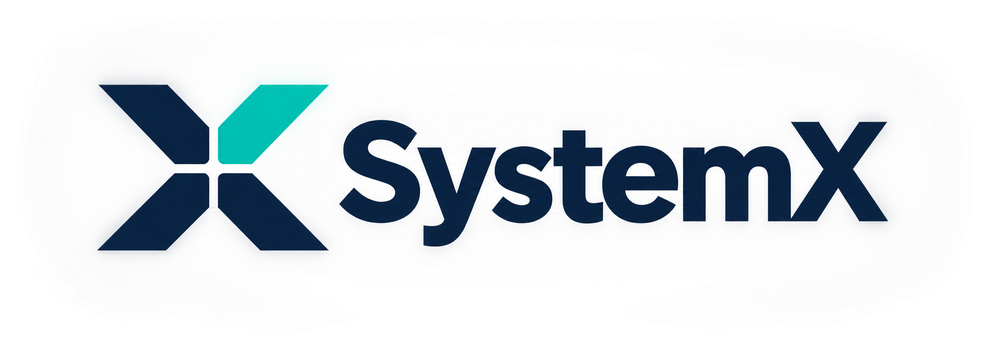
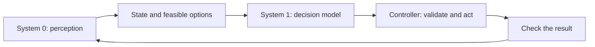

<p align="center">
  
</p>

<h1 align="center">Local intelligence for bounded decisions</h1>

<p align="center">
  Give your application a state, a question, and a set of options.<br>
  SystemX returns a decision. Your application stays in control of the action.
</p>

<p align="center">
  <a href="#quick-start">Quick start</a> &middot;
  <a href="#make-your-first-decision">API example</a> &middot;
  <a href="#game-integrations">Game integrations</a> &middot;
  <a href="docs/systemx-server-reference.md">Documentation</a>
</p>

<p align="center">
  
</p>

<p align="center">
  <em>From observation to verified action: a guided replay using recorded game frames,<br>
  recomputed OpenCV perception, and illustrative decision examples.</em>
</p>

## What is SystemX?

SystemX is a local HTTP service for applications that need to choose among defined
options. It turns observed state and question criteria into structured choices,
yes/no probabilities, or ordinal scores. Use it for routing, classification,
prioritization, or decisions inside an application control loop.

The current backend is **StartLux-Decision-v1.1-4B-Instant**, pinned to a specific
revision. Applications supply the feasible options, validate the answer, execute
the action, and check the result.

- **Three decision types:** select an option, estimate a yes/no probability, or score against an ordered scale.
- **Local inference:** run on CUDA or CPU, with offline startup once dependencies and model files are cached.
- **A small HTTP interface:** call it from any language, with readiness checks, batch requests, and interactive API docs.
- **Separate application logic:** game players and other clients use the same service while owning their state, rules, and execution.

## Quick start

**Windows is the tested target.** Install Python 3.12 and Git. GPU mode also needs
an NVIDIA driver compatible with CUDA 12.6. Allow about 9.3 GB for the model
checkpoint, plus several GB for dependencies.

```powershell
git clone https://github.com/Elykdez/SystemX.git
cd SystemX
& ./setup.bat
& ./start.bat
```

Setup creates a local `.venv`, installs dependencies, and downloads the pinned model. It requires internet access on a fresh checkout. You can also double-click `setup.bat` once, then `start.bat` for later launches.

Keep the server terminal open. In a second PowerShell terminal, check readiness:

```powershell
Invoke-RestMethod http://127.0.0.1:8000/health
```

Wait for `ready: true` and `status: ready`, then open the [interactive API docs](http://127.0.0.1:8000/docs) or try the example below.
Stop the server with **Ctrl+C** to release model memory.

<details>
<summary>Running on CPU</summary>

Pass `-Device cpu` during both setup and launch:

```powershell
& ./setup.bat -Device cpu
& ./start.bat -Device cpu
```

</details>

CUDA uses int8 inference by default, with worker count selected for the GPU.
See the server reference for [memory requirements and worker tuning](docs/systemx-server-reference.md#limits-and-client-behavior), [Linux setup](docs/systemx-server-reference.md#linux-setup), and [network access](docs/systemx-server-reference.md#network-access).

## Make your first decision

With the server ready, run this Python example from the repository root. It uses the standard library and the project's configured model name.

```python
import json
from urllib.request import Request, urlopen

from model_config import MODEL_NAME

payload = {
    "model": MODEL_NAME,
    "state": "I was charged twice for one order. Please refund the duplicate charge.",
    "questions": {
        "route": {
            "type": "choice",
            "instructions": "Which support team should handle this ticket?",
            "criteria": {
                "billing": "Payments, duplicate charges, invoices, and refunds.",
                "technical": "Crashes, access problems, and broken features.",
            },
        },
    },
}

request = Request(
    "http://127.0.0.1:8000/v1/systemone",
    data=json.dumps(payload).encode("utf-8"),
    headers={"Content-Type": "application/json"},
)
with urlopen(request, timeout=30) as response:
    result = json.load(response)

print(result["answers"]["route"]["choice"])
```

The result is a candidate key, such as `billing`. `state` can also be a structured JSON object, and one request can contain up to eight questions.

| Question type | Use it to | Returns |
| --- | --- | --- |
| `choice` | Select among 2–16 named options | Selected key, candidate probabilities, and confidence |
| `noul` | Evaluate a yes/no question | Probability of yes, from 0 to 1 |
| `score` | Rate against 2–10 ordered descriptions | Expected level index, probabilities, and confidence |

Confidence is the gap between the top two probabilities, not calibrated accuracy.
Your application should validate decisions before acting. The [API reference](docs/systemx-server-reference.md#api-contract) covers response fields, limits, authentication, and errors; the request examples](docs/systemx-server-reference.md#make-a-decision) also include PowerShell.

## Game integrations

The repository includes application-specific players that observe a game, build
feasible choices, and execute decisions through their own controllers.

| Integration | Input and behavior | Get started |
| --- | --- | --- |
| Minesweeper | One inspector and solver with browser-label and OpenCV screen-pixel adapters for classic rectangular boards | [Unified player](addons/minesweeper/README.md) / [Visual calibration](addons/minesweeper/DESKTOP.md) |
| Chrono Divide / Red Alert 2 | Interprets the visible game window and coordinates production, scouting, and combat through guarded mouse and keyboard actions | [Chrono Divide player](addons/chronodivide/README.md) |

Each addon has its own setup and launcher. **Starting the model server alone does
not start a game**.

Both game inspectors share a dark interface with an annotated observation preview,
a status banner, and a scrollable state panel. Wide windows show the preview and
inspector side by side; narrow windows stack them. Minesweeper shows its recognized
board, decision source, and verified move results. RA2 shows production, tracked
objects, persistent intent, and controller events. Capture and recognition problems
remain visible before input can continue.

Run `addons/minesweeper/play-minesweeper.bat` to select **Screen pixels** for a
desktop or browser game, or **Browser labels** for a supported webpage. New visual
themes require calibration or taught samples; nonstandard Minesweeper rules need
additional support.

Demo videos and GIFs use Git LFS. With Git LFS installed, run `git lfs install`
and `git lfs pull` in an existing checkout to download them. PNG images stay in regular Git.

## How the pieces fit

In the visual players, **System 0** interprets pixels, **System 1** evaluates
bounded choices, and the controller manages state and carries out actions.



OpenCV is the main perception tool; StartLux currently fills the System 1 role.
The model evaluates supplied observations and criteria. The controller owns input
and verifies outcomes. Other HTTP clients can supply their own state without a
visual perception layer.

**System 2**, an occasional strategic supervisor, remains a design proposal.
See the [role definitions and backend boundary](docs/system-one-model.md) for the implemented architecture and requirements for qualifying another provider.

## Documentation

| Guide | Contents |
| --- | --- |
| [Server reference](docs/systemx-server-reference.md) | Installation, API contract, configuration, lifecycle, and troubleshooting |
| [System 0 and System 1](docs/system-one-model.md) | Perception, decision-making, controller responsibilities, and backend boundaries |
| [Verification and performance](docs/systemx-server-reference.md#verification-and-performance) | Tests, real-model smoke checks, and measurement guidance |
| [System 2 proposal](docs/system-two-strategic-supervisor-design.md) | Planned strategic supervision; not implemented |
| [Third-party notices](THIRD_PARTY_NOTICES.md) | Upstream attribution and dependency and model license terms |
