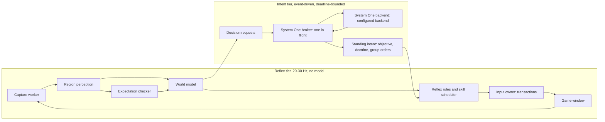

# Chrono Divide agent: design v2 (speed-first revision)

Terminology: [System 0 and System 1](system-one-model.md#system-0-and-system-1-in-the-current-player)
mean visual perception (mainly OpenCV) and bounded decisions (currently StartLux).
State, scheduling, skills and input verification are controller responsibilities.
A different decision backend requires qualification before use.

Status: historical architecture proposal. Sections below retain their original
scope and engineering targets; they are not a current implementation checklist.
For implemented behavior, use the [player guide](../addons/chronodivide/README.md)
and [validation report](chronodivide-validation.md). System 0 and System 1 are
implemented; the separate System 2 supervisor remains a proposal.

This revision merges an independently drafted design with
[chronodivide-visual-agent-plan.md](chronodivide-visual-agent-plan.md) (the "v1 plan").
The v1 plan remains the reference for research findings, perception data collection,
memory semantics, and qualification gates; this document keeps those and changes the
runtime architecture so the player can reach a high *effective* action rate.
Section 11 lists exactly what changed and why.

## 1. Goal and the central constraint

Build `addons/chronodivide/`: a player that observes only the visible game window,
acts only through mouse and keyboard input, keeps a compact persistent battlefield
description, asks System One for objectives and short actions, executes them via tested
skills, and verifies effects on later frames. Target: play complete skirmishes
against the built-in AI as fast and as usefully as the machine allows.

The constraint that shapes everything: **System One inference cannot be in the per-action path.**

| Fact (from this repo) | Consequence |
| --- | --- |
| Each worker accepts one inference at a time; extra requests get HTTP 429. | Budget work against the configured worker count. |
| Questions consume model inference capacity. | Measure packet latency with the configured model and worker count. |

So the design separates **intent** (System One, low rate, deadline-bounded) from
**execution** (deterministic reflexes and skills, high rate). System One chooses objectives,
doctrine parameters, production priorities, and group orders from bounded candidate
lists. Reflexes carry those choices out at full speed and never wait for System One. If a
decision misses its deadline, a logged rule default runs instead.

## 2. Scope of the first complete game

Same narrow starting scope as the v1 plan: one Soviet country, one land map, fixed UI
scale, window size, and team colors, one easy built-in AI opponent, a small army
vocabulary. The user starts the match. The player attaches when it recognizes the
in-match HUD.

Fair-play guardrail, which the v1 plan left open: the player runs only in local
skirmish against built-in AI, or in private games whose participants know about it.
It must not join public or ranked matchmaking against people. Check Chrono Divide's
terms before any online use. This is a product rule enforced by the controller (it
refuses to run when a ladder/lobby screen is classified), not only documentation.

## 3. Runtime architecture: three rates



| Tier | Rate | Owner | Examples |
| --- | --- | --- | --- |
| Reflex | 20-30 Hz ticks | Rules + skills | Keep every production lane busy per doctrine; place a finished building; fix low power; replace lost harvesters; send new units to the rally group; retreat a group below its stance threshold; move attention to an alert. |
| Tactical intent | Event-driven, ≤3 questions/s | System One | Order for a group that became ready, made contact, or finished its order; production choice when a lane is idle and ≥2 viable items remain after doctrine filtering. |
| Strategic intent | Every 10-20 s or on major events | System One | Objective (expand, tech, build army, defend, attack base X, harass, scout); aggression level (`score`); tech path. |

System One budget: keep average broker utilization ≤60% of measured capacity so urgent
questions see low queueing delay. The v1 plan's "tactical decisions up to 4-8/s" plus
production and strategy would saturate one serial model; this design routes most
tactical behavior through reflexes parameterized by System One's standing intent instead.

### Standing intent: how System One controls a fast player

System One writes *standing intent*, which the reflex tier reads on every tick:

- `objective`: one of 6-10 predefined objectives with explicit completion/abort conditions.
- `doctrine`: production emphasis (e.g. anti-armor / anti-infantry / economy / air
  defense) chosen from a list; aggression 0-4 from a `score` question.
- `group_orders`: per control group, one bound order (e.g. `attack_move → sector NE-ore`,
  `hold → base-choke`, `retreat → home`), each with an expiry.

This is the core speed idea. One decision can drive multiple inputs over the
next seconds, and every one of them stays legal, because reflexes re-bind targets
against current perception on each tick.

### System One broker

- One request in flight. One replaceable pending slot per decision key (e.g.
  `production:vehicle`, `group:2`, `strategy`). A newer request replaces an unsent older one.
- Priority order: urgent (base attacked, group in contact) > tactical > production > strategic.
  Urgent work cannot preempt an in-flight request; the next slot goes to it.
- Every request carries a deadline and a rule default. If the answer arrives late or
  its preconditions no longer hold, it is discarded and logged. Nothing waits on System One.
- Sole-candidate and forced cases (no refinery, power below demand, lane idle with one
  legal item) skip System One, as in Minesweeper.
- Optional memoization by (decision key, quantized state features) with a short
  TTL. Cache hits are logged as `systemone-cached` so provenance stays honest.
- Record decision provenance: `systemone`, `systemone-cached`, `default-after-deadline`,
  `invariant`, `sole-candidate`, `playbook`. This is the v1 plan's honesty
  requirement, extended to the deadline mechanism.

## 4. Perception: cheapest reliable source first

Perceive by region. Each region has its own cadence, change detection, and cache,
like the Minesweeper pixel-diff cache.

| Priority | Region | Technique | Output | Cadence |
| --- | --- | --- | --- | --- |
| 1 | Sidebar icon grid | Minesweeper-style fixed-grid template matching. Icons are exact sprites at a fixed UI scale. | Per slot: item ID, state (available / disabled / building + clock fraction / ready / on hold / queued count), active tab | On pixel change, ≤10 Hz |
| 1 | Credits, power bar | Digit templates; bar-level color measurement | Credits (exact or unknown), power margin | On change |
| 1 | Global UI mode | Screen classifier plus cursor-shape templates | In match / menu / pause / victory / defeat / placement mode / sell / repair / chat focus | Every tick (small crops) |
| 2 | Radar (when online) | House-color segmentation into a coarse grid | Own/enemy/ore/shroud per sector; camera rectangle → map position | 5-10 Hz |
| 2 | Placement ghost | Green/red footprint color check | Valid placement cells near an anchor | Only in placement mode |
| 3 | Selection feedback | Selection box/health-bar detection on known own-units | Selected count and health, "selection acknowledged" | Around transactions |
| 4 | Battlefield objects | House-color blobs first; compact detector (YOLOX-Nano/Tiny, ONNX) only if gates require it | Clusters with ownership, class when known, ground anchor, hit point | 5-10 Hz, plus native-resolution crops |

The sidebar and HUD stages are where Minesweeper's recognizer, teaching UI, profiles,
unknown rejection, and pixel-diff cache transfer almost directly. They are enough for
a complete macro game, which is why the delivery order below puts them first and the
battlefield detector later. The v1 plan put object detection in its first perception
stage. This design defers it to reduce early risk, and uses the running rules-bot to
collect the detector's training recordings.

Radar is not guaranteed. It needs the radar building and sufficient power (v1
finding). Before radar exists, and during low power, localization uses verified
camera bookmarks, the home/base key, and the fact that early play happens around the
construction yard. Perception must report radar as `unavailable`, not as "no enemies".

Use v1's observation contract unchanged: track IDs where useful, class and ownership
confidence kept separate, usable hit point versus bounding box, `unknown` preserved,
and uncertainty that blocks only the actions depending on it.

### Capture

- Keep `desktop/capture.py`'s `Frame` interface. Add a DXGI Desktop Duplication or
  Windows Graphics Capture backend behind it, with MSS as fallback. Benchmark latency,
  CPU, and game-frame impact before switching.
- One capture thread fills latest-value buffers per region. Consumers skip stale
  frames rather than process a backlog (v1).
- Do not capture a background tab or a minimized window: browsers throttle hidden
  pages, and the existing occlusion checks already pause on it.

## 5. World model (compact, persistent)

Use the v1 plan's memory model: current observations, last-seen map, commitments,
recent events, versioned game knowledge, and three explicit coordinate frames. Add:

- Own base knowledge comes mainly from the action ledger ("placed Barracks at anchor
  B2, construction confirmed"), then from sidebar tech inference (a newly enabled icon
  implies its prerequisite exists), then from visual confirmation. This gives a
  reliable base inventory without a battlefield detector.
- Army knowledge is organized by control groups the player itself assigned. Rally
  point plus auto-assignment makes group membership mostly a matter of bookkeeping.
- Credit reservations and a lane ledger, so two reflexes never spend the same credits
  or queue the same item (v1 requirement).
- A summarizer builds per-question packets: tactical ≤600 tokens, production
  ≤800, strategic ≤1,600 (v1 ceiling). Count tokens with the pinned tokenizer in
  tests. Never drop ownership, freshness, pending commands, or input-mode requirements.

## 6. Skills and the input owner

### Skill contract

Each skill is a small state machine. It declares:

- Its preconditions: UI mode, selection, camera revision, credits.
- One or more input transactions.
- Expectations: the observable effect, plus the deadline by which it must appear.
- Its cancellation points.
- Its verification level.

Initial set:

- MCV deploy.
- Queue/cancel item.
- Place building, with a spiral search over green footprints near a named anchor,
  preserving exits and ore access.
- Set rally point.
- Assign/select control group.
- Select same type.
- Attack-move / move / guard / stop / scatter group.
- Camera to bookmark / base / radar point.
- Repair/sell building.

### Transactions and interleaving (the APM mechanism)

The input owner runs short **transactions**: an atomic input sequence under about
50 ms, for example `key 2` → `attack-move modifier + click`. Preconditions are
re-checked right before each transaction, not by global pixel equality. Between
transactions, the owner can switch lanes, so production, construction, and army
work interleave. Only dependent steps wait. A move does not block the next queue
click.

Transaction classes, ordered by speed and robustness:

1. **Keyboard-only.** Control groups, stop, deploy, camera bookmarks, and sidebar
   hotkeys if the client provides them. These don't depend on pointer position, so
   pointer lock doesn't affect them. Prefer them.
2. **Sidebar/HUD clicks.** Fixed coordinates, independent of camera revision.
3. **Radar clicks.** Depend on radar being available and on the selection.
4. **Viewport clicks.** Depend on camera revision and a fresh hit point. Slowest; used last.

Batch a transaction into one `SendInput` call where the game accepts it. Keep a
measured minimum gap per event type. Browsers and game ticks can drop a key
down/up pair that falls within one frame. That gap is the true APM ceiling;
measure it in stage 0.

### Verification levels, earned by evidence

- **Strict**: wait for the expectation before the next *dependent* transaction. This
  is the default for every new skill and for anything with side effects on repeat
  (placement, sell, queue clicks that could cancel).
- **Optimistic**: register the expectation and continue. The expectation checker
  confirms it asynchronously. A mismatch invalidates the related ledger entry and
  forces a resync of that subsystem, never a blind retry.
- Promotion from strict to optimistic takes a threshold of live successes with zero
  wrong effects, for example 50. Any wrong effect demotes the skill. The controller
  shows each skill's level and evidence count.

This keeps Minesweeper's "verify the expected result, never repeat blindly"
discipline while letting proven skills run at full speed.

### Input layer changes (shared `desktop/`)

- Add keyboard input through `SendInput` with scan codes, plus modifiers, key holds,
  and drags. Release everything on cancel or exception.
- The existing modifier check (`GetAsyncKeyState` on Shift/Ctrl/Alt) must ignore
  modifiers the player itself is holding.
- Detect user takeover with a low-level mouse/keyboard hook
  (`WH_MOUSE_LL`/`WH_KEYBOARD_LL`) that reads the *injected* flag. Physical input
  pauses the player. Cursor-position comparison stops working under pointer lock,
  and the hook covers both modes. Keep the hook callback trivial and run it on the
  existing hotkey message thread.
- Allowlist input zones: the canvas only, excluding edge-scroll bands and browser
  chrome. Blocklist keys the browser handles: F5, Ctrl+W/T/N/R, Alt+F4, and
  Ctrl+1..9, which switch Chrome tabs and would break RA2's Ctrl+number group
  assignment. Verify in stage 0 which ones the page can intercept. Remap in-game
  bindings if needed.
- Controller hotkeys (currently F8/F9/F10) become configurable, to avoid game-binding conflicts.

### Pointer lock decision tree (resolve in stage 0)

1. If the client lets you disable pointer capture in windowed play, disable it. The
   existing absolute `SendInput` path then works unchanged.
2. Otherwise, use relative movement with closed-loop in-game cursor detection. This
   is slower (a few frames per target), which is another reason to prefer keyboard
   and sidebar transactions.
3. Never disable safety checks on a guess (v1).

### Environment setup

The user launches a dedicated Chrome window in app mode, using a separate profile
they log into themselves, at a fixed client size (e.g. 1600x900). Recommend a fixed
in-game UI scale and disabled edge scrolling if that option exists. Resolution, UI
scale, or zoom changes invalidate profiles and require recalibration.

## 7. Speed model and targets

Measure four different quantities separately (v1): raw input events/min, effective
game commands/min (effective APM), successful skills/min, and evidence age at
dispatch. Also track what speed buys: idle-production seconds, average credit
float, time to key milestones, and reaction delay to alerts.

Proposed latency budget per reflex tick, to be verified:

| Stage | Budget |
| --- | --- |
| Capture (region, fast backend) | ≤8 ms |
| HUD/sidebar/radar perception (cached, changed regions only) | ≤5 ms |
| World update + reflex scheduling | ≤3 ms |
| Transaction dispatch | ≤2 ms |
| **Urgent alert → first command** | **p95 ≤250 ms** (v1: ≤300 ms) |

Effective-APM targets, proposed: ≥60 after the macro stage, ≥120 in complete games,
stretch ≥200. Raw spam doesn't count. If a target is missed, fix the dominant stage
and don't loosen verification.

## 8. Development harness

Keep v1's separation: the official Game API playground and the Supalosa bot may be
used for controlled scenarios, opponents, and ground-truth perception scoring. They
never feed the live player's observations or decisions.

Build a recorder early: region frames at reduced rate, input transactions, perception
outputs, ledger, and decisions, stored in a bounded ring buffer under
`.cache/chronodivide/`. Save failure clips automatically. Replay drives offline
regression tests for perception and expectation checking with a simulated clock, as
Minesweeper does with saved screenshots.

## 9. Delivery stages and gates

Reordered from the v1 plan to put a playable rules baseline first. Gates are
proposals and should be refined after the first recordings.

| Stage | Deliverable | Evidence to continue |
| --- | --- | --- |
| 0. Client, input, and capacity spike | Record client version, settings, and control scheme. Resolve pointer lock. Measure the input-acceptance gap per event type. Check browser-reserved shortcuts. Test the low-level hook takeover. Benchmark capture backends. **Benchmark System One with synthetic 300/800/1,600-token RTS packets** (needs no game). | Repeated correct hits and key cleanup; measured ceiling of events/s; System One capacity curve; decision on absolute vs relative input. |
| 1. Recorder + passive HUD observer | Sidebar, credits, power, UI mode, radar (when online), annotated preview with ages. Minesweeper-style teaching UI for icons. | v1 HUD gate: ≥99% exact accepted readings at ≥90% coverage, on held-out sessions; report rejection rate. |
| 2. Macro skills + rules-only macro bot | Deploy, queue, place, power, harvesters, rally, group assignment; strict verification; lane interleaving. | ≥30 trials per skill with no duplicate queue, wrong placement, or stuck input; bot reaches a predeclared milestone (e.g. war factory + 6 tanks) by a fixed time in ≥9/10 runs; effective APM ≥60. |
| 3. Rules-only complete game | Group orders via keyboard/radar, basic viewport selection feedback, defend/attack playbook. | Complete games vs easy AI with all outcomes reported. **This is the baseline the selected System One backend must beat.** |
| 4. System One intent layer | Strategy, doctrine, production, and group-order questions through the broker with deadlines and defaults. | v1 qualification: ≥100 reviewed snapshots, option-order and wording tests, comparison with rules and random-valid choices. Then a live A/B against stage 3 with identical perception and executor. |
| 5. Speed tuning | Skill promotion to optimistic, fast capture backend, transaction batching, memoization. | Effective APM ≥120 and alert p95 ≤250 ms with no rise in wrong-effect rate. |
| 6. Battlefield detector and micro | Detector trained on stage 2-5 recordings; targeted attacks, retreat of damaged units. | v1 stage 1 detection metrics on held-out sessions, then v1's 20-game campaign. |
| 7. Generalization | Second map, Allied faction, colors, stronger AI. | v1 stage 5 criteria. |

The first implementation slice is stages 0-1. Stage 0's synthetic System One benchmark
answers the biggest architectural question, the question budget, before setting the live question budget.

## 10. Proposed layout

```text
server.py / backend.py / model_download.py   unchanged core
desktop/
  capture.py        + fast backend behind Frame
  input.py          + keyboard (scan codes), modifiers, drag, transactions
  hooks.py          new: low-level hooks for injected-vs-physical takeover
addons/chronodivide/
  __main__.py       calibrate | record | replay | play --policy rules|systemone | skill-test
  profiles/         layout.json, keymap.json (verified bindings), icon templates
  perception/       sidebar.py, hud.py, radar.py, modes.py, placement.py, objects.py
  world.py          observations, ledger, reservations, groups, summarizer
  reflex.py         rule defaults and doctrine execution
  skills/           contract + production, construction, army, camera
  executor.py       input owner, transactions, expectations, verification levels
  broker.py         System One requests, priorities, deadlines, memoization, provenance
  controller.py     watch / recommend / execute modes, preview, hotkeys
  recorder.py
  tests/            fixtures, replay tests, skill tests, decision qualification set
```

Keep RA2 knowledge and vision dependencies out of the core server. Leave Minesweeper
behavior unchanged; run its tests after every shared `desktop/` change.

## 11. Comparison with the v1 plan

### Adopted from v1 (my independent draft lacked or underweighted these)

- **Pointer lock / pointer capture.** My draft assumed absolute mouse positioning. v1
  correctly flags that this may not work, and that the cursor-based takeover check
  may break under pointer lock. This led to the hook-based takeover and the decision tree above.
- **Radar is conditional** on a building and power. My draft relied on the minimap as
  the primary global view; early game and low power need bookmark and base-key localization.
- **Classic vs modern control scheme** and customizable hotkeys: the keymap is
  verified data, not an assumption.
- **Game API and Supalosa bot as a separate dev lane** for opponents and
  ground-truth scoring, kept out of the player path.
- **Hit point vs box center**, UI modes changing click meaning, ownership confidence
  kept separate from class confidence.
- **Credit reservation and action ledger**; clicks whose repetition cancels actions.
- **Session-split datasets**, the System One qualification set, option-order tests, honest
  decision provenance, and the 20-game campaign gate.
- The watch / recommend / execute controller modes.

### Added by this revision (speed and APM, which v1 underweights)

| Issue in v1 | Change |
| --- | --- |
| Tactical System One rates of 4-8/s plus production and strategy exceed a single serial inference gate. | Three-rate architecture; System One writes *standing intent* executed by reflexes; a broker with priorities, deadlines, defaults, and a utilization cap. |
| Actions are paced roughly one command sequence per 250-330 ms, still a Minesweeper-style serial cadence. | Interleaved transactions across independent lanes; only dependent steps wait. |
| Every action verified before continuing. | Verification levels (strict → optimistic) earned by per-skill live evidence, with asynchronous expectation checking. |
| Mouse-centric skills. | Keyboard-first transaction classes; sidebar and radar clicks before viewport clicks. |
| Object detection in the first perception stage. | Sidebar/HUD first, via Minesweeper recognizer reuse; a rules-only macro bot provides a baseline early and generates detector training data. |
| No input-rate ceiling measurement. | Stage 0 measures the minimum accepted gap per event type, the real APM ceiling. |
| System One capacity unknown until later stages. | Synthetic-packet System One benchmark in stage 0; token budgets per question type. |
| Browser hazards not covered. | Input zone allowlist, browser shortcut blocklist (Ctrl+1..9 tab switching vs control groups), app-mode window, background throttling. |
| Capture stays on MSS. | Fast capture backend behind the existing `Frame` interface, measured before adoption. |
| Multiplayer listed as a later expansion. | Explicit fair-play rule: AI or consenting private games only. |

### Disagreements resolved

- **When to build the detector.** v1 builds it in stage 1; this revision builds it in
  stage 6. The HUD plus the action ledger can support a full macro game, and a
  running rules bot is the cheapest source of diverse training recordings. The v1
  detector evaluation criteria still apply, unchanged.
- **Where System One adds value.** v1 lets System One pick most tactical actions directly. This
  revision has System One set intent and parameters that reflexes execute. System One's decision
  count per game stays measurable and comparable to the rules baseline, and System One
  latency never throttles APM.

## 12. Open questions for the first spike

1. Can pointer capture be disabled in windowed play in the current client?
2. What are the actual default bindings? Are there sidebar hotkeys, attack-move, and
   bookmarks? Which browser shortcuts can the page intercept?
3. What is the minimum inter-event gap the game reliably accepts, for keys and for clicks?
4. What is System One's latency at 300/800/1,600 tokens on this GPU while the game renders?
5. Does the chosen map and AI setup allow repeatable spawn positions for A/B testing?
