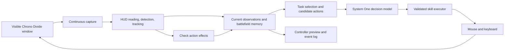

# Chrono Divide visual agent: research and plan

Terminology: [System 0 and System 1](system-one-model.md#system-0-and-system-1-in-the-current-player)
mean visual perception (mainly OpenCV) and bounded decisions (currently StartLux).
The controller owns state, candidate generation, skills and verified input.

Status: historical research proposal; nothing was implemented in this research
phase. For the current implementation and results, use the
[player guide](../addons/chronodivide/README.md) and
[validation report](chronodivide-validation.md).

## Recommendation

Build a dedicated `addons/chronodivide/` player around the existing SystemX
server. Its observation source is the visible game window; its outputs are mouse
and keyboard input. Use local image recognition to build a compact, persistent
description of the battlefield. Ask System One to select objectives and short actions
from that description. Execute those actions through tested game-specific skills,
then verify their effects on subsequent screenshots.

This is a substantial step beyond Minesweeper. The largest unknowns are recognizing
small animated units, maintaining camera-relative coordinates, handling the game's
mouse capture, and making useful decisions under incomplete information. The current decision backend's
speed does not establish its competence at these tasks. Test those uncertainties
before building an entire autonomous player.

Proposed first complete-game scope: one Soviet country, one land map, fixed UI
scale and team colors, one easy computer opponent, and a small supported army
composition. The user starts the match and attaches the controller. Earlier
milestones use observation and isolated building/combat exercises. General maps,
both factions, naval combat, superweapons, multiplayer competition, and automatic
lobby setup follow only after the narrow version works.

These are starting assumptions, not restrictions on the eventual product. The
specific map, country, starting conditions, controls, and opponent settings need
to be verified in the current client during the first implementation spike.

## What the research establishes

| Finding | Consequence for this project |
| --- | --- |
| Chrono Divide offers classic left-click and modern right-click control schemes. | Record the active scheme; avoid hard-coded assumptions about which click issues an order. [Official site](https://chronodivide.com/) |
| Its patch notes document customizable hotkeys, camera bookmarks, and pointer-capture/acceleration changes. | Input calibration, camera commands, and hotkey conflicts belong in the first spike. [Official patch notes](https://chronodivide.com/patch-notes.html) |
| The official Game API playground supports headless bot experiments and requires original RA2 MIX resources. | A separate development harness could provide opponents and repeatable scenarios. It does not replace the requested screen-controlled player. [Official playground](https://github.com/chronodivide/game-api-playground) |
| Supalosa's repository says its bot is integrated into the live game. | It is a useful source of game-specific engineering ideas and a possible baseline opponent; verify available settings in the client. Some older prose in its README is inconsistent with that integration statement. [Bot repository](https://github.com/Supalosa/supalosa-chronodivide-bot) |
| Cradle studies screenshots plus keyboard/mouse with separate perception, planning, memory, and skills. | Those separations are relevant design precedents, not proof of real-time RTS performance. [Paper](https://arxiv.org/abs/2403.03186) |
| AlphaStar used structured game observations; camera management and temporal memory were explicit concerns. | Borrow the attention and memory ideas. Its results do not demonstrate that a small text model can play from raw screenshots. [Research paper](https://storage.googleapis.com/deepmind-media/research/alphastar/AlphaStar_unformatted.pdf) |
| An independent AoE2 project describes local OCR/detection feeding text models, with a reported multi-second loop. | The perception-to-text arrangement has a concrete precedent. Its reported cadence would not meet our reaction target, and its game performance has not been independently verified here. [Project](https://github.com/dobosmarton/aoe2-agent) |

The original RA2 manual describes radar requiring the relevant building and power,
unexplored shroud, selection-dependent radar clicks, and distinct construction and
placement steps. These are useful test cases, but the current Chrono Divide client
is the authority for actual behavior. In particular, do not assume StarCraft-style
fog rules, an always-available minimap, or that clicking the minimap always moves
the camera. [Original manual, archived copy](https://oldgamesdownload.com/manual/command-conquer-red-alert-2-windows-manual-english/)

Research used public documentation and inspected local SystemX source. The web
reader exposed no useful interface text at `game.chronodivide.com`; this phase did
not verify a running match, current settings, pointer behavior, or exact hotkeys.

## Existing implementation constraints

The current core can be used unchanged:

- `server.py` accepts `POST /v1/systemone`; a choice question has 2-16 options,
  with at most 8 questions per request and a 64 KiB body limit.
- `backend.py` limits each packed question to 2,048 tokens, including state,
  instructions, and options. The combined question budget is 8,192 tokens.
  Oversized inputs fail rather than silently truncating.
- The configured checkpoint and revision are pinned in `model_config.py`.
  Requalify decisions and latency when changing them.
- The installed OptionMarker backend evaluates questions sequentially. Multiple
  questions in one HTTP body are not free parallel inference in this installation.
- Requests are stateless. The application must supply relevant memory explicitly.
- `desktop/` already provides region capture, physical coordinates, target identity,
  focus checks, cancellation, mouse input, and GPU sampling.

Reuse those desktop primitives where they pass RTS tests. Build a new session
controller: Minesweeper's requirement for an unchanged whole board is unsuitable
for a continuously moving battlefield. Keep Minesweeper's behavior intact.

## Architecture and ownership



| Component | Responsibility |
| --- | --- |
| System One backend | Evaluate bounded text questions through a provider adapter; the current SystemX server loads System One. |
| Shared desktop layer | Capture, coordinate conversion, target ownership, physical input, pause/stop. |
| Chrono Divide perception | Recognize HUD, objects, ownership, selection, build status, camera changes, and outcome. |
| Chrono Divide memory | Track observations, uncertainty, map sectors, groups, pending production, and recent events. |
| Chrono Divide decision adapter | Construct compact task-specific questions and map returned IDs to offered actions. |
| Chrono Divide skill executor | Select units, place structures, navigate the camera, issue orders, and verify acknowledgements. |
| Development harness | Fixtures, labeled clips, scenario testing, optional API opponents, and measurements. |

Start with one local addon process, one capture worker, one model-request worker,
and one input owner. Add a separate perception process only if profiling justifies
it. No new generic agent platform, plugin loader, database service, or network
broker is needed for the first version.

## Perception: turn pixels into useful observations

### Divide the image by purpose

| Region | Initial technique | Information |
| --- | --- | --- |
| Credits and power | Small native-resolution crops; digit templates or lightweight OCR | Amount, low/normal power, readability, last observation time. |
| Production sidebar | Icon templates, progress/overlay detection, OCR where needed | Available items, active tab, queue state, ready building, placement mode. |
| Battlefield | Small trained detector plus temporal tracking | Buildings, vehicles, infantry, ownership, approximate health when visible. |
| Radar/minimap, when available | Color/shape segmentation and motion comparison | Approximate concentrations, explored sectors, camera indicator if present. |
| Menus and modal overlays | Explicit screen classification | Loading, match, pause/menu, disconnection, victory/defeat. |

Begin with OpenCV/template recognition for fixed UI. Evaluate a compact detector
for battlefield objects; YOLOX Nano/Tiny are candidate architectures with documented
ONNX deployment, not models already trained to recognize RA2. Compare them with a
template baseline on actual screenshots before choosing. [YOLOX](https://github.com/Megvii-BaseDetection/YOLOX)

If templates fail on HUD text, evaluate a small OCR backend such as RapidOCR on
those crops only. Do not OCR the entire animated battlefield each cycle.
[RapidOCR](https://github.com/RapidAI/RapidOCR)

A large vision-language model may later help explain unfamiliar scenes or suggest
annotations. It is not a required component of the fast loop. Its annotations
would require review; they are not automatic ground truth.

### A bounding box is only the beginning

An observation should include a local track ID, candidate class, team/ownership,
bounding box, usable click region, ground anchor when applicable, visibility,
confidence, source frame, and timestamp. Separate ownership confidence from class
confidence. Preserve `unknown` values.

The center of a rectangular box may lie on background, an overlapping unit, a
shadow, or the wrong part of a tall building. Selection needs a tested hit point
or foreground mask; movement and placement need ground positions. Aircraft,
elevation, buildings, and overlapping sprites require separate handling.

Track objects between detections to avoid rediscovering everything each frame.
After a camera jump, reacquire objects before issuing screen-coordinate actions.
Do not promise persistent identity for every identical soldier. Track friendly
control groups and enemy clusters where individual identity is unnecessary.

UI modes are part of the observation: selected group, attack cursor, sell/repair
mode, placement ghost, active sidebar tab, chat focus, and modal overlays can all
change the meaning of the same mouse click.

Uncertainty should block the actions that depend on it. An unreadable enemy class
need not stop an independently verified production task; an unreadable production
queue must block another queue click. Reobserve or inspect uncertain targets. Loss
of window ownership or an unknown global input mode pauses all input. Requiring
every object on screen to be recognized would make the RTS player stall constantly.

### Collect the data the recognizer actually needs

The first recording pass should cover deployments, construction, selection,
movement, combat, damage, explosions, team colors, camera scrolling, shroud,
occlusion, and production completion. Start with a few hundred diverse frames and
short action clips, then expand according to observed errors; this is a collection
starting point, not a sufficient-data guarantee.

Label the limited initial unit/building vocabulary, ownership, actionable regions,
HUD values, and UI modes. Include unfamiliar objects and effects as negatives.
Split training and evaluation by match or recording session, not adjacent frames.
Otherwise almost identical animation frames can inflate reported accuracy.

Use uncertainty to select additional examples for review. Sprite assets may help
bootstrap templates or synthetic training examples, but testing must use actual
rendered scenes with terrain, scale, shadows, team colors, and overlap.

## Spatial and temporal memory

Maintain a local state store, initially plain typed objects plus bounded JSONL
diagnostics. A vector database is unnecessary for the initial player.

| Memory | Contents | Treatment |
| --- | --- | --- |
| Current observations | Visible objects, HUD, selection, camera, UI mode | Fresh evidence with timestamps. |
| Last-seen map | Base landmarks, explored sectors, resource locations, enemy sightings | Retain provenance and age; do not present old sightings as current. |
| Commitments | Active objective, group orders, construction requests, pending acknowledgements | Keep until confirmed, cancelled, failed, or explicitly superseded. |
| Recent events | Production completed, attack detected, group damaged, command failed | Bounded window, with important unresolved events retained. |
| Game knowledge | Supported build prerequisites, costs, controls, counters, skill definitions | Small versioned game-specific data, verified against the selected client/mod. |

Keep three coordinate systems explicit: physical desktop pixels, game viewport
pixels, and approximate map/sector positions. A camera revision invalidates old
viewport coordinates. An off-screen remembered target must first be reacquired;
its previous screen coordinates are unusable.

Start with named anchors such as home base, assembly point, and explored sectors.
Use verified camera bookmarks or bounded scrolling before radar is available.
Later use radar and observed terrain alignment to improve localization. Do not
require an exact reconstructed isometric world map before the first useful demo.
Do not assume a single flat transform handles terrain elevation and flying units.

Mobile enemy positions become uncertain quickly. Buildings are more persistent,
but an unseen building is neither confirmed alive nor confirmed destroyed. Going
off-screen is not death. Disappearance in a visible region may still be occlusion.
Track current visibility, unexplored shroud, and any game-specific concealment
separately rather than importing another RTS's fog model.

Camera attention is an action the agent must choose. It should inspect threatened
areas promptly and revisit base production and scouts before their information
becomes too old. A bounded maximum revisit interval prevents permanent attention
on one battle. Urgency and information age determine the schedule.

Prefer group-level orders and the game's existing movement/combat behavior before
attempting individual-unit micromanagement. The controller should establish the
intent, observe its outcome, and intervene when needed. It does not need to issue
an input for every animation update or every weapon shot.

## Context and decisions

Each System One call is a fresh decision packet. Do not append a screenshot transcript or
all previous decisions. A long match should enlarge local knowledge, not the next
prompt indefinitely.

Construct a packet for the pending task:

1. Current goal and the few game rules needed for this choice.
2. Relevant fresh observations, with ages and uncertainty.
3. Relevant commitments and unresolved recent events.
4. A short list of feasible candidate skills, normally 3-8.

Target roughly 500-1,200 packed tokens initially and an addon ceiling near 1,600,
leaving headroom beneath the server's 2,048-token limit. These are proposed budgets,
not measured optimal lengths. Count with the pinned tokenizer and actual packing
format. Drop irrelevant history and aggregate distant units first; never truncate
away ownership, freshness, pending commands, or input-mode requirements.

Use local queries to retrieve memory: a production decision needs credits, power,
prerequisites, queue state, strategic goal, and nearby danger; a combat decision
needs relevant groups, threats, terrain anchors, health estimates, and its current
order. It does not need the full construction history.

Illustrative decision packet, not a tested prompt:

```json
{
  "state": {
    "goal": "Protect the economy while building an armored force.",
    "camera": "west ore field",
    "credits": {"value": 1800, "age_ms": 250},
    "power": "normal",
    "friendly": "Group 1: five tanks, observed healthy, at west assembly point.",
    "threat": "Three enemy tanks seen approaching two miners; observation age 90 ms.",
    "production": "One tank already queued; no acknowledgement pending.",
    "memory": "Enemy base last seen northeast 24 seconds ago; current defenders unknown."
  },
  "questions": {
    "next_action": {
      "type": "choice",
      "instructions": "Choose the most useful next action. Use observation ages and protect the miners. Existing queued production does not need a repeated command.",
      "criteria": {
        "defend_west": "Order group 1 to defend the observed west ore-field approach.",
        "retreat_miners": "Move the threatened miners to the verified home refuge.",
        "inspect_northeast": "Inspect the last-seen enemy base before making an attack decision.",
        "maintain_orders": "Keep current orders and observe the engagement."
      }
    }
  }
}
```

Descriptions identify the actual choices and targets; candidate IDs refer to local
validated objects/skills. System One returns an offered ID. It does not generate arbitrary
coordinates, input code, or a long free-form plan. A response's confidence is not
the probability of winning, nor a substitute for perception confidence. Establish
decision thresholds on RA2 examples, including option-order and wording tests.

System One should make meaningful decisions about defend/attack/retreat/scout, production
priorities, and short-term targets. Code handles prerequisites, budget conflicts,
and mechanics. Record whether each decision came from the selected System One backend, an explicit invariant,
an active playbook commitment, or the sole available candidate. Avoid hiding most
strategy inside a rule system and then claiming the model learned to play.

For the first version, long-term structure comes from a small explicit playbook:
establish income and power, unlock production, assemble forces, scout, react to
threats, and attack when justified. Steps depend on observed completion and can be
interrupted. They are not fixed delays or a blind build-order macro.

If the selected System One backend performs poorly on held-out strategic choices, evaluate additional RA2
training examples or an optional slower strategic model that proposes goals.
That model would run only on major events or occasional replanning, outside the
input loop, and its proposals would expire when the state changes. Neither a new
model nor a cloud dependency is part of the initial implementation recommendation.

## Skills and action verification

Build a small library of finite-state skills with preconditions, steps,
acknowledgements, completion conditions, timeouts, and cancellation points.

| Skill | Example verification |
| --- | --- |
| Select a unit/group | Selection feedback and expected ownership/type appear. |
| Deploy the starting MCV | The expected construction structure and sidebar become visible. |
| Queue a supported item | The intended queue icon/count/progress changes. |
| Place a completed structure | Placement is valid, the placement mode ends, and construction appears. |
| Move or attack-move a group | Correct group remains selected and begins the intended movement/order. |
| Attack a visible target | Target is reacquired and attack feedback follows. |
| Retreat a group | Movement toward the verified refuge starts; continue monitoring danger. |
| Visit a camera anchor | Visible landmarks/viewport position match the expected area. |

For construction, distinguish requesting production, acknowledgement, production
finishing, entering placement mode, and placing the structure. A completed build
queue does not necessarily mean a building exists on the map. Inspect the placement
preview and preserve exits and resource access; do not guess placement solely from
an empty rectangle. Exact feedback must be learned from the current client.

Likewise, command acceptance and task completion are different. After a move is
acknowledged, the scheduler may tend production while units travel. Do not block
the entire agent until the group reaches its destination. Do not repeat the order
each frame and continually reset useful behavior.

Maintain an action ledger and reserve proposed spending so two tasks do not queue
the same item or spend the same credits. A timeout means uncertain outcome; inspect
the UI before retrying. Some repeated clicks cancel or change existing actions.

One input owner arbitrates the camera, selection, modifiers, mouse, and sidebar.
Perception and inference may overlap; competing input sequences must not. Emergency
defense can interrupt routine work at a defined boundary, release held inputs, and
reestablish UI mode and selection before proceeding. It must not interrupt halfway
through a drag and start issuing unrelated clicks.

## Continuous operation and speed

The key metric is the age of the evidence when an effective command is issued,
including tail latency. Capture frequency, inference frequency, physical clicks,
and useful game commands are four different measurements.

Proposed starting schedules, subject to measurement:

| Work | Initial target |
| --- | --- |
| Capture and lightweight tracking | 15-30 updates/second. |
| Full battlefield detection | 5-10 updates/second, plus camera changes or lost tracks. |
| HUD/sidebar reading | 2-5 updates/second and immediately around dependent actions. |
| Tactical System One decisions | Up to 4-8/second while needed; fewer when an order remains useful. |
| Production/attention decisions | 1-2/second or on relevant events. |
| Strategic objective review | Every 5-15 seconds or after a major event. |
| Controller preview | About 5/second, independent of capture. |

These rates share capacity; they are not independent guaranteed workloads. One
deadline-aware scheduler prevents slow strategic queries from building a queue
ahead of urgent tactical decisions. The core has one inference gate. Allow one
request in flight and one replaceable pending state; cancellation invalidates an
old result locally even if GPU computation cannot be stopped.

Keep captures and observations in bounded latest-value buffers. Skip outdated
frames instead of trying to process a backlog. Preserve meaningful events and
pending commitments separately so dropping a frame does not erase a production
acknowledgement already observed.

Associate a candidate with run generation, geometry/camera revision, group or
target identity, required UI mode, and expiration. Revalidate those dependencies
just before input. A moving target can be located again in a newer frame; a changed
credit balance or irrelevant animation need not invalidate a combat command.
Global pixel equality would continually reject valid RTS actions.

Aim initially for ordinary useful command sequences roughly every 250-330 ms when
needed, with a proposed urgent observation-to-dispatch p95 budget below 300 ms.
That is an engineering target, not a result. Split measurements into capture age,
perception, memory, prompt packing, inference, input, and visual acknowledgement.
If targets are missed, slow the tested scenario and fix the dominant stage.

### Apply the proposed capture-quality optimization

Use a coarse overview for attention and native-resolution crops for small objects,
HUD text, ownership, and final hit-point verification. Preserve source-to-crop and
resize transforms through to input coordinates. Benchmark scales such as 1.0,
0.75, and 0.5 against the same labeled scenes. Halving both dimensions removes 75%
of pixels, but can erase infantry, ownership marks, and health bars.

Set a minimum useful object size from the recognition tests. Tiny detections trigger
a detailed crop; dense or overlapping combat may need a higher-resolution pass.
Keep a periodic full-viewport scan so local crop tracking cannot miss new threats.
Treat camera motion separately from object motion. Cache static UI and templates,
not the entire animated scene as if it were an unchanged Minesweeper board.

Avoid JPEG encoding, image-to-base64 conversion, and network transfer in the local
perception path. Reuse buffers and show a throttled preview. Benchmark CPU/GPU
competition with the game running before assigning more stages to the GPU.
If a GPU ONNX detector is adopted, profile input/output copies before considering
I/O binding; it can reduce avoidable transfers but does not make CPU-captured
frames magically zero-copy. [ONNX Runtime documentation](https://onnxruntime.ai/docs/performance/tune-performance/iobinding.html)

Retain pooled HTTP to the core initially. Our earlier Minesweeper measurements
found approximately 2.4 ms median for decision time outside server-reported
computation, including planning/serialization/transport. That is not an RTS result
or a pure HTTP measurement. A WebSocket may later serve a remote dashboard or
perception stream, but changing transport is not the first optimization experiment.

## Input and control-mode investigation

Before any model-controlled match, test screen-to-input mapping in the actual
client. Pointer lock/capture can decouple the operating-system cursor from an
in-game cursor. Under browser pointer lock, ordinary position properties remain
constant while relative movement continues. [Pointer Lock API](https://developer.mozilla.org/en-US/docs/Web/API/Pointer_Lock_API)
The current absolute-position SendInput implementation and pointer
takeover check may therefore need a separate Chrono Divide input mode. Establish
the behavior with a controlled target sequence; do not disable checks on a guess.

Verify single clicks, right clicks, modifier combinations, short key holds, box
selection, control groups, camera bookmarks, and scrolling. Check the configured
scheme and conflicts with browser/controller hotkeys. Test movement at multiple
locations, then a known selection and visible acknowledgement. If relative input
is needed, calibrate it and observe the game's cursor/target feedback.

Retain foreground ownership, geometry invalidation, user takeover, and immediate
pause/stop. Release all injected keys and buttons on cancellation or exception.
An addon pause stops the agent; it does not imply the running match has paused.
Show this distinction in the controller. Avoid parking the cursor near an edge
that scrolls the camera or over a UI control with side effects.

## Controller experience

Keep the familiar attach, preview, step, run, and pause workflow, with three clear
modes: watch only, recommend without input, and execute. The first useful prototype
should already show labeled regions, current camera/selection, active objective,
pending commands, and which observations are stale or unknown.

Show the chosen skill and the evidence supplied to the decision, along with real
stage timings and the last verified result. Do not fabricate a reasoning transcript
for System One, which returns typed answers rather than a written explanation. Let the
user inspect a failure frame and correct labels while paused. Display game version,
vision profile, and supported settings so an unsupported scene is recognizable.

## Decisions to resolve with the first experiments

| Uncertainty | Cheapest informative experiment | Decision it controls |
| --- | --- | --- |
| Does ordinary absolute mouse input reach the intended game point? | Repeated visible target selections under the current pointer settings. | Reuse the mouse primitive or implement a tested relative-input mode. |
| Can fixed UI be read cheaply and reliably? | Labeled HUD crops across construction and power changes. | Templates alone or a small OCR component. |
| Can small units and ownership be distinguished? | Detector/template comparison on held-out real clips at several crop scales. | Detector choice, training needs, minimum resolution, supported unit classes. |
| Does the selected System One backend make useful RTS choices? | Small early reviewed state set, then the larger qualification set. | Prompt/candidate revisions, additional training, or optional strategic model. |
| Can the player navigate without radar? | Leave home, inspect a nearby area, and return using visible landmarks and verified camera commands. | Initial camera strategy and memory representation. |
| Does more GPU work harm the game or System One latency? | Repeat the same recorded/live workload with CPU and GPU perception. | Runtime placement, detector cadence, resolution, resource budget. |

Treat these as explicit decision points. If compact vision and System One cannot meet the
narrow task, revise the architecture before expanding the supported game surface.

## Development API: a useful separate lane

The official API is valuable for constructing controlled experiments, inspecting
rules, running baseline bots, or generating replay candidates. Keep it out of the
live visual player's observation and action path. Ground-truth instrumentation
in a separate development harness can measure recognition error, provided it is
not fed into the visual agent's decisions.

Confirm version/resource compatibility before depending on replay tooling. A
headless engine does not automatically supply rendered screenshots or aligned
training labels. Where replay rendering is available, record the player's view,
not an omniscient observer view. Manual screenshot labels remain a valid initial
oracle. No API package or game resources were installed during this planning phase.

## Evaluation and staged delivery

All gates below are proposed acceptance criteria, not completed tests. Refine them
after the first recordings reveal the actual image quality and interaction model.

| Stage | Deliverable | Evidence required to continue |
| --- | --- | --- |
| 0. Client/control spike | Record version, settings, viewport, input mode, selected game conditions; verify primitive input. | Repeated correct hits, drag and key cleanup, reliable camera return; characterize pointer capture and demonstrate takeover/pause. No System One inference required. |
| 1. Passive observer | Read HUD, initial supported objects, ownership, selection, camera, and UI mode; show annotated preview and ages. | Held-out clips from separate sessions. Report per-class precision/recall, ownership errors, HUD exactness, unknown rate, and coverage; include no-radar and camera-jump cases. |
| 2. Verified skills | Deploy, queue, place, select, move, visit anchors, and cancel one skill at a time. | At least 30 varied trials per initial skill, including failure/timeout cases. No unintended target, duplicate queue, or stuck input in the test set; report rejected attempts. |
| 3. Decision qualification | Evaluate the selected System One backend on at least 100 reviewed tactical/production snapshots; add isolated combat and threat-response exercises. | Compare with a simple rule baseline and random valid choice. Test changed resources, stale sightings, option order, uncertainty, and emergency interruption. Establish where the backend helps and where it fails. |
| 4. Narrow complete games | A complete skirmish on the selected map/faction/opponent configuration. | Predeclare a 20-game campaign across both supported spawn positions; report all wins, losses, stalls, pauses, and failures. A useful first target is at least 10 wins, not a guarantee. Attribute losses by perception, mechanics, strategy, or environment. |
| 5. Generalization | Second map, varied colors/UI scales, more unit types, stronger opponent. | Held-out scenarios and the same end-to-end metrics; no retraining on test clips or silent benchmark changes. |

For stage 1, a proposed initial HUD gate is at least 99% exact accepted readings
with at least 90% coverage under the supported settings. Require no observed
ownership-induced wrong-target decisions in the held-out action cases. These finite
test results are not guarantees; always report sample counts and rejection coverage.
Detection accuracy alone cannot qualify click automation.

Use saved clips, simulated clocks, and mocked decisions for regression tests.
Use limited real System One calls for prompt/latency qualification and live integration.
Replay traces must include frame times, source regions, object IDs, memory used,
offered choices, selected action, input events, and verified effect. Record short
failure clips and a bounded ring buffer rather than unbounded full-session images
by default. Preserve snapshots of the client, profile, model, and prompt versions.

Measure effective commands and successful skills, not just click count. Include
time to first income/production, idle production time, resource float, reaction
delay, repeated-command rate, stale-result rejection rate, and game outcome.
Compare System One and the rule baseline using the same perception, executor, settings,
and reproducible scenarios where supported. Distinguish observed facts from
estimates derived from incomplete screen coverage.

## VRAM and system load

Previous SystemX measurements on this RTX 3070 with 8 GiB recorded approximately
763 MiB Torch allocation at idle, 784 MiB peak allocation, and 878 MiB peak
reservation for the tested short requests. Whole-device before/after differences
were roughly 1.05-1.1 GiB and included unrelated applications. Those results are
documented in `docs/minesweeper-validation.md`; they are not a prediction
for long RTS prompts, another vision model, or a running Chrono Divide match.

For the proposed addon, measure separately: desktop baseline; game alone; game
plus the System One backend; game plus perception; all components active; and post-shutdown. Report
whole-device usage alongside each model runtime's allocation where available.
Include warmup and dense-combat peaks, game frame time, CPU load, and inference
p50/p95. Torch counters do not account for an ONNX runtime's allocations.

Keep HUD processing on CPU initially. Compare detector CPU and GPU execution with
the game active. Use an incremental AI budget around 2 GiB as an initial design
ceiling to investigate, not a promised footprint. If accuracy or speed exceeds
that budget, choose the detector/input workload from measurements before adding a
larger model. No additional model was loaded or VRAM benchmark run for this plan.

## Proposed file boundaries

```text
server.py / backend.py / model_download.py    existing generic core
desktop/                                    shared capture and input primitives
addons/minesweeper/                          existing addon
addons/chronodivide/                         proposed new addon
  perception/                               HUD, objects, tracking, profiles
  state.py                                  observations, memory, coordinate frames
  decision.py                               compact System One requests and candidates
  skills.py                                 verified action state machines
  controller.py                             scheduling, UI, lifecycle
  play-desktop.bat / setup-desktop.bat        later launch/setup entry points
tests/chronodivide/                          proposed clips, skills, decision cases
```

These names describe a possible implementation; no launcher or module above was
created. Extract additional reusable desktop behavior only when this second addon
demonstrates a concrete shared need. Keep RA2 knowledge and optional vision packages
outside the server's requirements and API.

The recommended first implementation slice is the control spike and passive
observer, plus a tiny offline decision set to expose limitations of the selected System One backend early.
That produces a visible, measurable result: the controller shows what it sees,
what it remembers, what is uncertain, and the action it would choose, before a full
game depends on all of those components working together.
