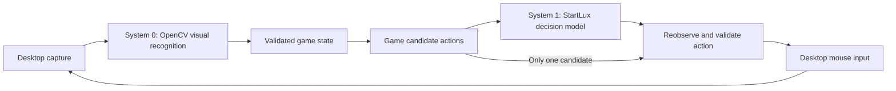

# Desktop visual player design

Terminology: [System 0 and System 1](system-one-model.md#system-0-and-system-1-in-the-current-player)
mean visual perception (mainly OpenCV) and bounded decisions (currently StartLux).
The visual adapter supplies observations; game logic constructs legal candidates;
the controller validates, executes and verifies the chosen action. A different
decision backend requires qualification before use.

Status: initial implementation available; acceptance testing is incomplete.
Prepared 2026-09-23 against SystemX and the Minesweeper addon. See the
[usage guide](../addons/minesweeper/DESKTOP.md) and
[validation/VRAM report](minesweeper-validation.md) for implemented
behavior, measured results, and deferred gates. Sections below retain the design
targets; they are not claims that every target has been implemented or verified.

## Purpose and scope

Add a reusable desktop observation and input layer. Keep SystemX as a general model HTTP server. Game addons interpret images, maintain game state, construct candidate actions, and verify outcomes. Minesweeper is the first consumer.

Initial target: Windows 10/11, an interactive desktop, a visible window, and ordinary rectangular Minesweeper with eight-neighbor rules. Support the existing web game through pixels and at least one native implementation. The user opens the game and starts a board; the player attaches to it without a URL or browser extension.

Support across appearances means tested recognition profiles and explicit calibration. It does not mean every arbitrary skin works immediately. Hexagonal boards, 3D boards, remote-session edge cases, exclusive fullscreen, obscured/minimized play, menu navigation, and automatic rematches are outside the first release.

## Separation of responsibilities



| Component | Owns | Does not own |
| --- | --- | --- |
| SystemX server | Model loading and typed decisions | Screen capture, UI, mouse access, game rules |
| Shared desktop library | Target window, captured frames, coordinates, focus checks, input, cancellation | Minesweeper cells or strategies |
| Minesweeper visual adapter | Grid detection, cell classification, terminal recognition, appearance profiles | Server lifecycle |
| Minesweeper session | Board validation, candidate selection, decision freshness, expected click result | Windows capture implementation |
| Desktop controller UI | Target selection, calibration preview, step/run/pause/stop, local status | Inference hosting |

The controller runs on the machine displaying the game. The existing model server may run locally or at a configured server address. Only structured state and choices go to that server; screenshots remain local. Closing the controller leaves an independently started model server running.

## Existing code to reuse

- `addons/minesweeper/board.py`: validated `Board`, `Cell`, `Box`, and `Candidate` types.
- `planner.py`: visible-board deductions and candidate generation.
- `decision.py`: bounded choices through the existing HTTP API; the model does not interpret images.
- `session.py`: observe, decide, reobserve, click, and verify. Its current driver methods are `observe`, `click`, and `wait_for_change`.
- `browser_driver.py` and `observe.js`: retain the existing DOM player as an independent mode and useful development reference.

The current Board requires every cell to be known. Do not expand its states to accept uncertain visual classifications. Keep uncertainty in a separate visual observation; only construct a Board after validation. An incomplete observation pauses the visual player with a reason. It is never converted to an empty or covered cell by default.

The session needs small, explicit extensions: recoverable visual pause reasons, frame/geometry revision checks, cancellation immediately before input, and action-specific postconditions. Preserve DOM behavior with regression checks. Avoid a new universal strategy framework.

## Proposed source layout

```text
server.py, backend.py, model_download.py   existing core, unchanged
desktop/                                new shared Python library
  capture.py                            screen-region frames
  target.py                             window identity, geometry, DPI
  input.py                              bounded mouse input and stop gate
addons/minesweeper/
  ...                                   existing game logic and DOM driver
  visual/                               image interpretation and profiles
  desktop_driver.py                     adapts desktop vision to session
  desktop_player.py                     controller and game-specific UI
  play-desktop.bat                       optional desktop entry point
  setup-desktop.bat                      optional vision dependencies
docs/desktop-visual-player-design.md     this proposal
```

Names are proposed implementation locations, not existing commands. Start with ordinary modules, not plugin registration, IPC services, or dynamically loaded action scripts. Extract further shared UI only when a second game requires it. Keep vision packages out of root server requirements.

## Desktop capture and coordinates

Start with Python MSS for visible screen-region capture and OpenCV/NumPy for CPU image processing. MSS supports region capture and OpenCV integration. Pin versions after a Windows/Python 3.12 compatibility spike. [MSS documentation](https://python-mss.readthedocs.io/stable/)

Attach to a selected window identity using its handle, process ID, and process creation identity. A saved profile must not silently attach to another window with the same title. Capture the visible client region using its current physical desktop rectangle. Require the complete board to be visible.

Each frame records a sequence ID, monotonic capture time, target identity, capture origin, pixel size, DPI, and geometry revision. Cell AABBs are in capture-local physical pixels. Convert their centers into desktop physical pixels exactly once in the input layer. Preview scaling never changes stored input coordinates.

Use a consistent per-monitor DPI awareness context before capture/UI initialization. Prefer a manifest for a packaged executable; a Python entry point must establish and verify its context early. Windows documents that API-based process DPI setup must occur before DPI-dependent operations. [DPI documentation](https://learn.microsoft.com/en-us/windows/win32/api/winuser/nf-winuser-setprocessdpiawarenesscontext)

Any move, resize, monitor change, browser zoom, or grid-size change invalidates pending actions. Pause and reacquire the grid; require preview confirmation if calibration no longer matches. Do not silently stretch old cell coordinates onto new content.

Windows Graphics Capture is a possible later backend if measurements show a need. Its window/display capture API does not remove the need to verify that desktop mouse input will reach the intended target. [Windows capture documentation](https://learn.microsoft.com/en-us/windows/uwp/audio-video-camera/screen-capture)

## Perception and calibration

1. On a frozen preview, the user selects the board region and confirms rows and columns. Offer automatic grid detection as a suggestion, then confirm it. Manual calibration is the initial dependable path.
2. Estimate repeated cell spacing and grid boundaries; reject irregular spacing or a clipped board. Generate cell rectangles from one validated grid rather than independent noisy detections.
3. Normalize each cell crop for size and border thickness. Match covered, empty, flag, mine, and digits 1-8 using profile templates, shape, and color features. Color alone is insufficient. OpenCV template matching measures visual similarity; it is not a calibrated probability of correctness. [OpenCV documentation](https://docs.opencv.org/4.x/de/da9/tutorial_template_matching.html)
4. Require both a sufficient match and separation from competing labels. Establish thresholds on labeled fixtures, including unfamiliar appearances. Missing digit templates produce unknowns. Start with verified bundled profiles; allow users to label sample cells while paused and save a separate local profile.
5. Require stable labels across consecutive captures before accepting a board. Check Minesweeper constraints and impossible transitions, but never rewrite a recognized number merely to satisfy the solver. Consistency checks do not prove recognition is correct.
6. Show recognized numbers, flags, and unknown cells in a separate annotated preview. It must not cover or contaminate the captured game region. Only a complete validated board may reach the planner.

A visual observation contains grid geometry, raw labels or unknowns, class scores, profile version, frame identity, and a status classification. Recognition confidence and mine-risk estimates are separate concepts throughout logs and UI.

Profiles also describe visible win/loss indicators and flag behavior. A mine counter often shows remaining unflagged mines, not total mines: use a user-confirmed total or a tested profile conversion, otherwise leave `mines_total=None`. Unknown terminal appearance pauses as "outcome unconfirmed"; it must not claim a win. A stable explicit terminal cue or a complete supported rules-based terminal condition is required.

Begin from an unflagged board by default. The existing planner treats flags as correct mine claims. Attaching mid-game with user flags requires confirmation of that assumption; observed flags are not proof of mines. Initial clicks and later guesses remain uncertain unless the game's rules explicitly guarantee them.

## Decision and input contract

Keep System One's current role: choose among legal candidates supplied by Minesweeper logic. Skip inference for a sole candidate. Never ask it to resolve an unreadable digit or invent an unseen mine location. No raw model response can become an arbitrary desktop coordinate.

Associate every pending decision with its board fingerprint, geometry revision, profile revision, and run generation. Increment the run generation on pause, stop, recalibration, and restart. A late HTTP response from a previous generation is discarded.

Immediately before a click, reobserve and require the same validated board, target identity, geometry, and active run generation. Recheck foreground ownership, target containment at the click point, absence of held user buttons/modifiers, and the stop event. Input goes only to the selected target while it is foreground; never repeatedly steal focus. Unexpected pointer movement before the controller's own move pauses execution.

Use Windows SendInput for absolute pointer positioning plus paired button-down/up events. Account for virtual-desktop origin, negative monitor coordinates, and absolute input normalization. Check the returned event count. Windows limits injection by process integrity level; report a failure instead of escalating privileges automatically. [SendInput](https://learn.microsoft.com/en-us/windows/win32/api/winuser/nf-winuser-sendinput), [mouse coordinates](https://learn.microsoft.com/en-us/windows/win32/api/winuser/ns-winuser-mouseinput)

The input owner serializes actions, checks cancellation just before dispatch, and releases any button it pressed during cleanup. There is still a small OS scheduling race between the final check and injected input; do not claim atomic protection against another application taking focus.

Verify the expected result, not just any changed pixel. A reveal must change the selected cell to a revealed state or show a validated loss; a flag must change it to a flag. An expanding empty region is valid. Timers, hover colors, window movement, and unrelated animations are not success. On timeout or ambiguity, pause without repeating the click: a repeat can undo a flag or trigger a different action.

## User flow and lifecycle

1. Start SystemX separately when using the System One model. Launch the proposed desktop Minesweeper player.
2. Select an already open game window, select or calibrate the board, and choose a recognition profile.
3. Inspect the recognized board in preview. Unknown cells are highlighted with an actionable reason.
4. Focus the game and use a registered global hotkey to step or run. The controller must not require moving focus to its own console for each action. Show the assigned hotkeys and fail clearly if registration conflicts.
5. A global stop hotkey remains responsive during capture or inference. Controller UI and cancellation run independently of blocking model requests. Pause cancels permission to dispatch pending decisions, even if an HTTP request cannot be interrupted immediately.
6. Focus loss, stale geometry, uncertain perception, contradictory clues, model failure, or input failure pauses with a reason. Terminal result stops play. Resume always starts with fresh observations.

State flow: selecting -> calibrating -> preview/paused -> observing -> deciding -> revalidating -> acting -> verifying -> observing. Every active state can pause or stop. Calibration is mandatory again when the grid becomes invalid. Window closure ends the attachment. Closing the controller disposes capture/input resources; it does not close the user's game.

Keep the existing URL-based Playwright entry point usable. Desktop mode selects a window and does not navigate pages, resolve certificates, or launch a replacement browser profile.

## HTTP and optional WebSocket transport

Keep HTTP as the initial inference transport. The existing `SystemOneDecision` already
uses one persistent `httpx.Client`, which pools and reuses connections when
available. WebSocket is therefore not simply removing a connection handshake
from every move. Idle HTTP connections can expire; benchmark actual request
cadence rather than assuming every call reuses a warm connection.
[HTTPX client documentation](https://www.python-httpx.org/advanced/clients/)

WebSocket is an optional future transport for frequent bidirectional messages:
state updates, decisions, and controller status. FastAPI supports persistent
WebSocket connections and JSON messages. This can also serve a separate browser
dashboard if one is later needed. An in-process desktop preview should use local
events instead of adding a network hop.
[FastAPI WebSocket documentation](https://fastapi.tiangolo.com/advanced/websockets/)

Changing transport does not reduce recognition or model computation time, remove
the network round trip for a dependent decision, or remove the wait for a visible
game response. System One returns a bounded decision, not a stream of generated tokens.
No latency improvement is claimed until measured.

If benchmarks justify a WebSocket inference endpoint, implement it as a thin,
optional transport adapter sharing the existing request validation, authentication,
readiness checks, input limits, inference concurrency gate, and model instance.
Keep HTTP available. This would require a separately scoped transport integration;
it is not implemented by this design and does not change model/game logic. Do not
insert a WebSocket-to-HTTP proxy and assume that the extra hop speeds inference up.

The proposed message envelope contains protocol version, message type, session ID,
request ID, state revision, and run generation. A decision response echoes those
IDs and carries the existing answer payload. Validate identity and freshness
locally before considering an action. Never transmit an executable mouse command
directly from the model endpoint.

Allow one inference request in flight per player and at most one replaceable
pending state. New observations replace unsent old observations; they do not
build an unbounded queue. Cancellation invalidates pending results immediately
on the controller, but does not promise to interrupt already running GPU work.
Separate status receiving from inference so pause/stop stays responsive.

A disconnect pauses action dispatch. Reconnect starts a new session generation,
takes a fresh observation, and requires explicit resume; never replay previous
clicks or decision responses. Use bounded messages and queues, authenticated
connections, and TLS for remote authenticated deployments. Large preview frames
must not queue ahead of control messages; the initial design sends no screenshots
to the model server.

Benchmark warm pooled HTTP against warm WebSocket with identical payloads on
localhost and the intended LAN. First use a stub decision engine to isolate
transport overhead, then a small fixed real-model sample. Record median and p95
request latency, end-to-end action latency, CPU cost, stale-result rate, and
disconnect recovery. Adopt WebSocket for inference only if the gain matters to
the target game's response budget; streaming UI requirements can justify it
independently. Transport work follows trustworthy capture and perception.

## Cost and diagnostics

Use CPU vision initially, with no second large model and no GPU allocation for recognition. Capture on demand around actions; poll briefly for animation settling, then stop polling at a bounded deadline. Proposed starting values are 5 Hz preview, up to 10 Hz while settling, two consistent observations, and a three-second result timeout. These are tuning defaults, not performance claims.

Reuse classifications only for unchanged crops under the same geometry/profile revision. At most one decision and one input action may be pending. Begin with a conservative one-action-at-a-time cadence; measure before increasing it.

Measure capture, recognition, inference, and action-verification latency separately, plus CPU/RAM and model VRAM. The existing server still retains model VRAM while loaded. Report CPU-only perception overhead separately from model inference.

Store bounded local session logs in `.cache/minesweeper/desktop/`: observed labels, revisions, decision source, intended cell, actual desktop point, and outcome. Save cropped board images on uncertainty/failure; optional detailed recording saves before/after crops per action. Record profile versions for replay. Do not retain full desktop screenshots by default.

## Implementation stages and acceptance gates

| Stage | Deliverable | Required evidence before proceeding |
| --- | --- | --- |
| 1. Capture and coordinate spike | Select a window, capture region, show preview, map a grid onto a test surface | Correct cell hits on a controlled click-recorder at 100%, 125%, 150%, and 200% scaling; moved windows and a secondary monitor with negative origin; no model calls |
| 2. Passive Minesweeper vision | Calibration, profiles, labels, uncertainty and terminal detection | Held-out web and native screenshots with hand labels; every accepted board exactly matches labels; unsupported crops reject; report rejection rate as well as accuracy; no mouse input |
| 3. Step mode | One verified action per request with stop/pause gates | Controlled tests for focus loss, overlays, geometry changes, unknowns, delayed model response, cancellation, and failed click; zero unintended or duplicate clicks in the suite |
| 4. Complete games | Autonomous run using the existing planner and System One | At least ten attempts on each of the web and native targets, with recorded terminal outcomes or explained pauses; report recognition failures separately from legitimate losses on guesses |
| 5. Packaging and regression | Desktop setup/launcher and docs, DOM regression coverage | Fresh-environment installation; desktop use needs no Playwright/plugin; existing DOM mode and server tests still pass; measure resource use |

Stage 2's exact-match gate is a release condition for the supported fixtures, not a guarantee on all future images. Evaluate precision and rejection coverage together so a recognizer that rejects everything does not pass. Define supported themes and minimum acceptance coverage from the collected fixtures before enabling automatic play.

Use saved screenshots, mocked decisions, and the controlled click surface for most development. Load the selected System One backend only for limited integration and final live tests. Screenshots used by the visual player must not contain hidden game state; a controlled test harness may know expected click results solely for verification.

## Decisions deferred until evidence exists

- Which native Minesweeper implementation and appearance profiles constitute the initial support list. Select an installed target during the capture spike; do not purchase or install a game as part of this design.
- Whether templates generalize enough. If held-out appearance tests fail, evaluate a small cell classifier with labeled data. A vision-language model remains a separate option requiring latency, VRAM, and recognition-error measurements.
- Whether desktop capture meets frame-quality needs. Consider a Windows Graphics Capture backend only for an observed limitation.
- Warcraft-specific detection, object tracking, camera transforms, held keys, drags, and real-time planning. Reuse proven desktop primitives later, but do not force Minesweeper's turn-based board/session abstractions onto it.

Recommended next step: stage 1 and passive stage 2. Establish trustworthy pixels and coordinates before connecting visual decisions to live mouse input.
