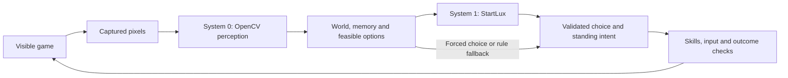

# System One decision model

System One is the role that makes frequent, bounded decisions from observed
state. It is separate from the provider, checkpoint, transport, and execution
of the chosen action.

| Term | Meaning |
| --- | --- |
| SystemX | This repository and its current HTTP server. |
| System One / System 1 | The application-facing decision-model role. |
| Configured backend | The current implementation, checkpoint and revision in `model_config.py`. |
| StartLux | The currently configured System 1 backend, not the name of the whole player. |
| Jev or another provider | A possible future System One backend, requiring an adapter and qualification. |
| System 0 | Perception: turn visible input into aged, sourced observations. |
| System 2 | Proposed occasional strategic LLM: assess trends and steer System One. |

## System 0 and System 1 in the current player

These names describe engineering responsibilities, not levels of human cognition.
OpenCV is the main implementation tool for System 0; StartLux currently fills
the System 1 role. The surrounding controller has responsibilities of its own.

| Part | Job | Output | Does not do |
| --- | --- | --- | --- |
| System 0: visual perception | Use OpenCV/NumPy, calibrated templates, colors and geometry to interpret captured pixels. An optional learned unit detector also belongs here. | Observations such as HUD mode, credits, available icons, radar contacts, ownership, selected units and health, with unknown or uncertain readings preserved. | Choose a strategy, invent offscreen enemies, or send input. |
| State and rules | Age and reconcile observations, retain remembered facts, track reservations and cumulative production, and construct currently feasible choices. | A compact battlefield state and bounded questions with criteria, deadlines and rule defaults. | Treat remembered facts as fresh sightings or cumulative production as surviving army strength. |
| System 1: StartLux | Evaluate the supplied state and question criteria, then choose among the offered options or return the requested typed score. | A bounded decision used to update standing intent or a tactical/production choice. | Read the game window itself, discover hidden game state, generate arbitrary input commands, or own the mouse. |
| Skills and executor | Recheck preconditions, bind decisions to fresh visible targets, sequence input, and inspect later frames for the result. | Guarded actions and evidence of success, failure or an unresolved outcome. | Assume that an accepted decision or delivered click proves the game performed the action. |

### System 0: what is observed

In Chrono Divide, `perception/reader.py` updates HUD and sidebar observations;
the other readers inspect radar, placement, units, buildings and selected health
bars. `perception/scene.py` tracks visual objects across nearby frames.
`world.py` and `intel.py` retain and age this evidence for later decisions.
Confidence, missing data and observation age limit which actions are feasible.
A camera change or stale sighting does not establish the current offscreen state.

Detection and heuristics can report evidence of a threat or estimate its strength.
Deciding whether to defend, where to inspect next, or which force to commit belongs
to the decision/controller path, rather than to OpenCV image matching itself.

### System 1: what to do with the evidence

The current Chrono Divide integration sends StartLux structured facts and bounded
questions through `/v1/systemone`, rather than asking it to interpret screenshots.
The faction JSON profiles define the wording, candidates, criteria and defaults.
Questions cover spending, force size, scouting, resources, production and Prism
tactics such as hold, bombard, reposition or advance.

`StandingIntent` retains the chosen workflow focus: attack, defend or build.
The visual/controller loop checks for changed incidents on the profile's interval;
it does not replace that focus on every frame. A valid answer can steer many
subsequent skill actions. The broker handles asynchronous requests and deadlines;
the controller rejects stale or infeasible answers and records whether a choice
came from the model, a cache or rules. Forced choices and fallback actions are
not additional StartLux decisions.

### Example and test assets

For a damaged factory, System 0 recognizes its owned sprite and selected health
bar. State/rule code checks freshness, repair policy and available funds; a repair
skill enters repair mode and clicks only after those checks. Later visual evidence
is needed to establish recovery. This deterministic repair path need not ask
StartLux, while the broader spending or defense decision may do so.

Runtime calibration assets live in the client profiles. Captured screenshots in
`tests/fixtures/` test System 0 recognition and the controller's reaction to that
evidence. They are not StartLux training data and are not loaded for normal play.

System 2 remains a separate, unimplemented supervisory proposal. The current
System 0 / System 1 / controller loop already plays without it.

## Current behavior and proposed boundary

The server loads the pinned model in `model_config.py` through `backend.py`.
The current adapter uses bidirectional attention.
AutoThink is not enabled. Clients use the exact model ID, the `systemone` policy,
and `SYSTEMX_*` environment variables. The `/v1/systemone` endpoint and
`SystemOneClient` remain the application boundary.

The [server reference](systemx-server-reference.md) documents the current
implementation; the [System 2 prototype](system-two-strategic-supervisor-design.md)
describes future supervision and backend decoupling.

Propose an adapter at the application decision-client boundary. The game supplies
facts, feasible candidate IDs, strategic context, and a deadline. The adapter
translates these into the selected provider's request and normalizes its answer.
The controller still validates the result, updates intent, executes skills, and
verifies the outcome.

## Minimum decision contract

| Element | Requirement |
| --- | --- |
| Request identity | Decision ID/kind, match, generation, decision epoch, and strategic directive revision. |
| Inputs | Observed state, bounded feasible candidates with descriptions, and typed strategic preferences. |
| Timing | Explicit deadline; asynchronous completion must not block the control loop. |
| Result | One offered candidate ID, or an unavailable/invalid outcome that invokes the application's rule fallback. |
| Provenance | Backend ID, model/revision, adapter/profile revision, elapsed time, and model versus fallback source. |
| Optional capabilities | Yes/no probabilities, ordinal scores, candidate probabilities, and confidence only when supported and validated. |

Candidate generation, resource reservations, freshness checks, emergency rules,
and action ownership belong to the application. Provider-specific prompting,
token limits, authentication, error mapping, and transport belong to the adapter.
The profiles' inherited situation-matching wording is specific to its adapter/profile, not a
universal requirement for System One.

Do not treat different providers' confidence values as interchangeable. The current adapter's
confidence is a top-two probability gap, not calibrated correctness.
A new backend must not fabricate unsupported optional scores.

## Replacing the backend later

Select backend, endpoint, model, and adapter/profile revision independently of
the policy mode (`system1_only`, `hybrid`, `system2_only`, or `shadow`).
Include provider identity and revisions in cache keys. A backend switch starts
a new decision epoch, clears incompatible cached/in-flight decisions, and
preserves verified state and pending action acknowledgements.

A future Jev adapter must be based on its actual supported API, capabilities,
authentication, deployment location, and measured latency. The current server
does not accept Jev model IDs. This is a design boundary, not a promise that
providers are already interchangeable.

Qualify each adapter using the same decision scenarios and controller invariants,
then measure latency and decision quality. Evaluate a backend change separately
from a System 2 change so its effect can be assessed.

Return to the [README](../README.md) for setup and addon links.
