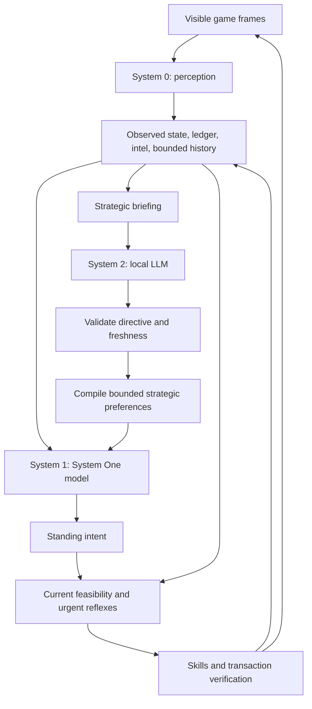

# System 0 / System 1 / System 2: strategic supervisor prototype

Status: **System 2 is design only; not implemented or executed**. Research date: 2026-09-30.
The existing System 0 / System 1 player is implemented; see the
[current role definitions](system-one-model.md#system-0-and-system-1-in-the-current-player).
No model downloads, inference, gameplay, services, or runtime changes accompany
this proposal. All timings, limits, and evaluation gates below are proposed
starting points, not measurements or demonstrated performance.

## 1. Intent and scope

Add an occasional local LLM that reviews the whole situation, evaluates whether
the current plan is working, and steers the System One model's subsequent choices.
System One (currently StartLux) makes frequent bounded decisions; System 0
(mainly OpenCV) interprets screens; existing controller skills carry out and
verify actions. System 2 would supervise these decisions, not replace perception
or take ownership of input.

The immediate application is the Chrono Divide addon. Keep the core SystemX
service application-neutral. The labels System 0, 1, and 2 describe engineering
roles, not a claim that these models reproduce human cognition.

**System One (System 1) is the decision-model role, independent of checkpoint
or provider.** A qualified backend fills that role through an adapter without
changing System 2's directive contract, game intent, or action executor. See the
[shared System One interface](system-one-model.md) for terminology and the
provider boundary used across the documentation.

Assumptions: "the top two models" means System One and the new strategic LLM; either
can provide decisions independently. "Send scouts" means obtain information
before choosing whether to attack, rather than treating silence as proof that
the enemy is weak. Initial game knowledge remains Soviet-specific and comes
from the existing JSON profiles.

Success means System 2 can detect a persistent strategic problem, issue a small
reviewable directive, influence feasible decisions, and evaluate the outcome
without delaying perception or urgent defense.

## 2. Existing architecture and constraints

These references describe the current working tree, including ongoing local
changes. Existing changes are not part of this proposal.

| Existing component | Relevant behavior | Design implication |
| --- | --- | --- |
| [Core service](../server.py), [vision registry](../vision.py) | System One evaluates typed questions; TorchScript image models can stay resident. | Keep LLM generation in a separate optional service. |
| [Perception](../addons/chronodivide/perception/reader.py), [World](../addons/chronodivide/world.py) | Screens update aged facts, production lanes, commitments, and remembered structures. | Use observed state and reservations, not hidden game APIs. |
| `World.snapshot()` | Includes credits and age, power, lanes, structures, cumulative units, reservations, and radar. | It is a useful input, but not a complete strategic briefing. |
| [Intel](../addons/chronodivide/intel.py) | Records enemy-base location, aged looks, scout state, and a visual defense-strength heuristic. | Old radar dots and pixel strength do not prove current enemy strength. |
| [Army](../addons/chronodivide/army.py) | Tracks campaigns, confirmed failures, scouts, recent censuses, and committed forces. | Distinguish fresh surviving-unit evidence from cumulative production. |
| [Reflex](../addons/chronodivide/reflex.py), [StandingIntent](../addons/chronodivide/intent.py) | Offers feasible choices and updates persistent objective, posture, intel, resources, attack size, and production. | A separate strategic directive should steer these decisions, not compete as another writer. |
| [Broker](../addons/chronodivide/broker.py) | Asynchronous System One requests, deadlines, generations, fallbacks, and urgent-route reservation. | Keep System One scheduling separate from System 2 generation; generalize provider transport behind an adapter. |
| [Decision profile](../addons/chronodivide/profiles/startlux-ra2-soviet.json) | Normally asks strategy every 15 seconds; wording is tuned to situation matching. | Free-form instructions from another model are not an established steering interface. |
| [FramePlayer](../addons/chronodivide/frame_player.py) | Emits transactions for a caller to acknowledge; it does not send desktop input. | Preserve action ownership and later-frame verification in every mode. |

`World.events` holds only 64 recent events and is not included in its snapshot.
Longer history, observation coverage, strategic revisions, and reliable income
estimates need explicit future adapters. The current miner monitor calls a cash
rise after a gem order **source unverified**; System 2 must preserve that caveat.

The [Chrono Divide validation report](chronodivide-validation.md) records live
Soviet and Allied wins, along with the limitations of those debugging runs.
Fresh visual strength counts, income evidence and action ownership remain
necessary; the results do not establish a need for System 2. Decisions about
resource relocation belong in the model path.

## 3. Research basis

[Chain of Summarization](https://arxiv.org/abs/2312.11865) combines observations
across frames for strategic decisions in TextStarCraft II. This supports giving
System 2 a compact temporal briefing rather than an isolated screenshot.

[HIMA](https://arxiv.org/abs/2508.06042) uses a strategic planner to coordinate
specialized proposals into an overall plan. This supports separating strategic
direction from local choices. It is not evidence that a generic local LLM will
improve this screenshot-driven Red Alert 2 player: the environment, observations,
models, and training differ. We borrow the hierarchy, not its multi-agent
implementation or reported performance.

The research motivates a hypothesis: slower review of trends can improve
long-term choices while a fast controller handles immediate operations. Compare
that hypothesis against both current System One behavior and a simple rule supervisor;
an LLM must earn its additional memory and latency cost.

## 4. Layer responsibilities

| Layer | Inputs | Output | Frequency |
| --- | --- | --- | --- |
| System 0: perception | Visible screens, taught detectors, HUD and radar evidence | Observations with source, age, and uncertainty | Each available fresh frame |
| System 1: System One model (configured backend) | Focused facts, feasible options, compiled strategic context | Typed local choices | Configured deadlines and cadence |
| System 2: local LLM | Current briefing, trends, operations, prior directive outcomes, game knowledge | Assessment and bounded strategic directive | Periodic review and debounced strategic events |
| Controller and skills | Accepted intent, current observations, task state | Verified input transactions | Every controller tick |

System 0 does not invent plans. Deterministic reflexes sit beside these model
layers and preserve immediate response. System 2 has no mouse, keyboard, browser,
shell, or arbitrary tool authority; its strategy reaches the game through the
same controller as System One decisions.



System 2 chooses the direction and conditions for changing it. System One decides the
next feasible step within that direction. The controller enforces actual
availability, spending reservations, observation freshness, and emergency needs.

### Replaceable System One backend

The proposed application boundary is a bounded decision request and normalized
response. It does not require every provider to expose SystemX's HTTP API.

| Contract element | Provider-independent meaning |
| --- | --- |
| Request | Decision ID/kind, observed facts, feasible candidate IDs and descriptions, compiled strategic context, deadline, match/generation/epoch, and directive revision. |
| Required result | One selected candidate ID from the supplied set, or an explicit unavailable/invalid outcome. The controller applies the existing fallback for failures. |
| Optional result | Yes/no probability, ordinal score, candidate probabilities, or confidence metadata only when the adapter supports and validates their semantics. |
| Provenance | Backend ID, model/revision, adapter/profile revision, timing, and whether the decision came from the model or a fallback. |

The decision adapter translates that request into current state/questions and
normalizes its answers. A future Jev adapter translates the same request into
its supported API and normalizes the response. Verify the actual Jev contract,
authentication, deployment location, capabilities, and latency before adopting
it; this document does not claim an existing compatible adapter.

Keep game knowledge, feasible choices, strategic priorities, and standing intent
outside provider code. Put provider-specific wording, packing, limits, and
transport behavior inside the adapter and its decision profile. The strategic
compiler supplies typed context; each adapter translates it into a representation
qualified for that model. The profile's situation-matching vocabulary is one such
representation, not a requirement for all System One models.

The minimum gameplay contract requires bounded choices. Do not require a new
backend to reproduce optional probability/score features it does not support,
and do not compare confidence values across providers as if calibrated alike.
The configured adapter's top-two probability gap keeps its documented meaning.

Configure backend, endpoint, model, and adapter/profile revision separately from
`system1_only`, `hybrid`, and other policy modes. Key decision caches by backend
and model/profile revision as well as state and directive revision. A backend
switch invalidates in-flight decisions and caches through a new decision epoch,
while preserving verified game state and action acknowledgements. Use an
explicitly selected provider rather than automatic cross-provider fallback.

## 5. Independent operating modes

| Proposed mode | Decision ownership | Failure behavior |
| --- | --- | --- |
| `system1_only` | Selected System One backend makes decisions, with no strategic LLM dependency. | Existing rule defaults. |
| `hybrid` | System 2 directive steers System One; System One owns local choices. | Invalid, late, or expired directives disappear; System One keeps running. |
| `system2_only` | The LLM selects bounded intent through the same validator; deterministic skills maintain it between reviews. No System One calls. | Rule defaults handle urgent or unmet needs and directive expiry. |
| `shadow` | System One plays; LLM assessments and proposed changes are logged only. | LLM availability has no effect on actions. |

Independent operation still requires System 0 and the shared controller. An LLM
acting every minute will not replace frame-level control. A mode switch clears
pending model results and starts a new decision epoch; it preserves verified
world facts and outstanding action acknowledgements. Never let both models write
the same standing-intent field concurrently.

## 6. Strategic briefing and memory

Build one immutable snapshot for each review. Start with structured data; use
the LLM to assess it, not to manufacture missing measurements. Include:

- Identity: match ID, controller generation, decision epoch, observation revision,
  capture time, profile revision, supported faction, and policy mode.
- Economy: fresh credits, reserved and spendable credits, known refineries and
  miners, power state, resource-field evidence, production progress and stalls.
- Forces: fresh census and health, its scope and age, cumulative production
  separately labeled, committed groups, campaign status, and confirmed failures.
- Enemy and map: recent sightings, approximate visual defenses, scout progress,
  known resource targets, radar availability, shroud, and observation coverage.
- Operations: queued, confirmed, failed, and cancelled commitments; outstanding
  verification; task failures and reasons; current System One intent and provenance.
- Trends: 30-, 60-, and 120-second windows of observed economy, base losses,
  verified force changes, threats, and progress toward the previous directive.
- Prior review: accepted directive, age, observed outcomes, unmet conditions,
  and unresolved uncertainties. Do not insert earlier model claims as facts.

Attach stable evidence IDs to source observations and events. Important claims
must cite these IDs. Preserve missing values as `null` or `unknown`. An adapter
must atomically copy relevant component state or record inconsistent revisions
and decline that review; a world lock alone does not lock Army and Intel.

Propose a bounded history of up to ten minutes, with aggregate time buckets and
a capped set of significant events. Do not retain every screenshot or an
ever-growing conversation. Keep the original records behind each aggregate.
When coverage is incomplete, report it rather than describing the window as
quiet. An enemy out of view remains unknown even with perfect home observation.

Cash change is not income: spending, delivery, refunds, and unknown events affect
it. Report cash trend first. An income estimate requires recorded spending and
sufficient observations, carries an uncertainty flag, and is never a verified
gem delivery solely because credits increased.

Use controller seconds for the prototype because that is what the current
profile uses. Keep monotonic expiry time separate from match-relative elapsed
time; record game speed and pauses. Do not assume these seconds are game time or
compare raw timings across speeds and controller restarts without normalization.

## 7. When System 2 runs

Proposed initial settings belong in a future JSON strategic profile:

| Setting | Initial proposal | Purpose |
| --- | --- | --- |
| First review | After 30 seconds of usable observations | Avoid planning from an empty initial state. |
| Normal review | Every 60 controller seconds, only if relevant evidence changed | Assess trends without frequent inference. |
| Trigger cooldown | At least 20 seconds between starts | Coalesce several related events. |
| Request deadline | 8 monotonic seconds from submission | Discard slow results; never wait on the player thread. |
| Directive lease | Up to 120 monotonic seconds after acceptance | Prevent indefinite steering. |
| Minimum plan hold | 30 seconds, unless invalidated | Limit oscillation. |
| Concurrency | One request in flight; one replaceable pending snapshot | Bound load and keep newest evidence. |
| Input budget | At most 4,000 backend-tokenized tokens | Bound prefill, memory, and briefing size. |
| Final answer budget | At most 700 tokens | Keep assessment and directive compact. |

Strategic triggers include a confirmed campaign loss, a verified critical
structure loss, repeated production failure, sustained resource stagnation, new
enemy composition, newly observed resource opportunities, or prolonged silence
with stale enemy intelligence. These are changes to a plan, not every new frame.

An immediate raid invokes the existing urgent path first. A later review can
change recovery priorities. If a raid invalidates a pending strategic assessment,
discard it on return. Expiry remains monotonic even if observations stop; pause,
reload, or HUD loss invalidates directives and in-flight reviews.

## 8. Output contract and acceptance

The LLM produces a structured assessment and a directive. This illustrative
JSON is a proposed System 2 payload, not a current API or System One decision request:

```json
{
  "schema_version": 1,
  "assessment": {
    "summary": "A failed attack and weak economy favor recovery before another push.",
    "position": "disadvantaged",
    "economy": "fragile",
    "enemy_intent": "unknown",
    "evidence_ids": ["campaign-loss-3", "cash-window-60", "census-17"],
    "uncertainties": ["Enemy forces outside the last camera view are unknown."]
  },
  "directive": {
    "mode": "recover",
    "priority_order": ["base_survival", "economy", "intel", "army"],
    "risk": "low",
    "attack_policy": "hold_new_waves",
    "intel_goal": "refresh_enemy",
    "economy_goal": "restore_income",
    "production_focus": "miners_then_army",
    "requested_lease_seconds": 90,
    "review_when": ["economy_recovered", "new_enemy_threat", "scout_report"]
  }
}
```

The controller attaches request identity, snapshot revision, issue and acceptance
times, model and quantization identifiers, and the final lease expiry. The LLM
does not author authoritative timestamps or replace controller identity.

Prototype enums are closed: position is `advantaged | balanced | disadvantaged |
unknown`; economy is `healthy | fragile | stalled | unknown`; mode is `maintain |
recover | investigate | pressure`. Enemy intent remains `unknown | preparing |
attacking | retreating`, with evidence required for claims beyond unknown.
Preference values come from the JSON strategic profile, with no arbitrary unit
IDs, targets, numeric thresholds, code, or commands generated by the model.

Acceptance checks schema, lengths, enums, evidence references, mode support, and
current feasibility. Unknown evidence IDs reject the directive. Evidence
references provide traceability, not proof that the inference is correct.
Unsupported strategic claims downgrade to unknown or reject the affected plan;
model confidence alone cannot authorize it.

Reject responses after deadline, from another match/generation/epoch, or based
on material facts that changed. Routine snapshot revision changes alone should
not reject everything: compare critical assumptions such as current threat,
refinery availability, relevant census, and target validity. Enforce leases and
invalidate active directives by the same rules. Never apply partial streaming
JSON. On rejection retain an already-valid directive until expiry, otherwise
use baseline behavior. Do not run unbounded formatting retries during gameplay.

## 9. How steering reaches System One

Do not make free-form LLM summaries the steering contract. A deterministic
compiler maps accepted enums into bounded strategic facts and preferences.
The selected System One adapter then prepares the decision request. For the
configured adapter, use a small authored vocabulary and reviewed criterion
variants in JSON: its profile records sensitivity to wording and situation
matching. Other adapters can use different qualified representations of the
same strategic context.

For each decision: derive genuinely feasible candidates from current facts,
apply profile-defined strategic preferences, supply relevant facts to System One,
and revalidate the result before changing intent. Strategy must not overwrite
observations, fabricate a need, or alter model probabilities after the fact.
Rule defaults consume the same bounded context when System One is unavailable.

| Directive | Proposed influence | Required boundary |
| --- | --- | --- |
| `investigate` + `refresh_enemy` | Prioritize producing/grouping scouts, then scouting or a fresh enemy look. | Only available affordable units; verified scout group and supported target/radar prerequisites. |
| `recover` + `hold_new_waves` | Favor gathering, economic repair/replacement, and reserve protection. | Urgent defense still wins; existing committed units need a supported return/recall path. |
| `restore_income` | Favor refinery/miner recovery or resource reconnaissance; consider a known gem field. | No relocation to invented coordinates or stale/unsafe targets; preserve a verified miner. |
| `low` risk | Prefer larger feasible attack thresholds and postpone optional tech spending. | Keep profile floors and limits; time elapsed alone cannot establish enemy weakness. |
| `pressure` | Favor a feasible attack after fresh evidence and adequate defense/economy. | Never lower attack prerequisites or remove emergency anti-air coverage. |

This is a real integration change, not just a new prompt. In particular, current
posture criteria favor attack once the force threshold is reached; a recovery
context needs explicit tested support for gathering despite reaching that
threshold. Current `defend` is offered for a recent threat, so preemptive defense
should usually map to `gather` plus recovery priorities. Do not invent a currently
unsupported `rebuild` objective or `retreat` command.

The smallest prototype uses authored criterion variants and priority ordering.
An accepted `hold_new_waves` is an explicit leased strategic constraint: it may
temporarily remove optional new offensive orders, but never forced defense or
essential recovery. If preference filtering leaves nothing usable, restore the
baseline feasible set and log the conflict. Emergency/profile constraints have
precedence over strategic preferences, which guide System One's remaining choices.

Record directive revision in System One request context and cache identity. A callback
from an older revision must revalidate against the current directive or be
discarded; otherwise a late attack answer could undo a recovery plan. Log both
model choice and any controller override with the reason.

## 10. Required example behaviors

### Long enemy silence

Input: several adequately observed quiet home windows, stale or missing enemy
intel, no immediate raid, and enough economic capacity for a small scout effort.
System 2 reports enemy intent as unknown and selects `investigate`. System One first
chooses affordable scouts if needed, then a supported scouting/look action after
production and grouping are verified. A scout already out is not duplicated.
Poor home coverage instead calls for fresh observations. No scout or radar means
a prerequisite plan or an explicit unsupported outcome, not an invented order.

The next review uses the report to decide whether to pressure, defend, or keep
building. Silence alone never authorizes attack or a smaller attack force.

### Losing and rebuilding

Input: a confirmed failed attack, a fresh low survivor census, damaged/lost
critical infrastructure, or a sustained fragile economy. Avoid comparing our
cumulative build count against an unknown enemy army to declare a global loss.
System 2 selects `recover`, protects essential spending, holds new attack waves,
and prioritizes verified recovery needs. System One chooses legal purchases and local
posture; urgent threats can still demand defense.

Evaluate recovery by fresh army evidence, functioning prerequisites, and
observed economy progress. Reassess after a stable improvement rather than
alternating offense and defense at every review. If an existing campaign cannot
be safely recalled with current skills, record that limitation; the LLM cannot
promise to save it. Recovery is bounded by its lease and reviews, not permanent
inactivity.

### Base alive but economy stalled

Input: weak cash trend, repeated idle/blocked production, repeated thin home ore
evidence, and a recently observed alternative field. System 2 requests income
recovery; System One evaluates the existing `resources` choice using current evidence
and compiled recovery context. The resource skill selects a verified miner,
issues the supported order, and observes its outcome. Movement, a harvest order,
and a verified income source are three different results. Missing target or
unsafe evidence leads to reconnaissance or rebuilding, not manual LLM control.

## 11. Local model and runtime choice

Use one local text-only strategic request first, even if the checkpoint supports
images. Existing System 0 supplies screen evidence. A later screenshot audit is
a separate experiment and must not silently override verified perception.

| Candidate | Proposed use | Selection caution |
| --- | --- | --- |
| [Qwen3.5-4B](https://huggingface.co/Qwen/Qwen3.5-4B) | First current-family small-model candidate, quantized. Its official card documents thinking control. | Benchmark final-answer deadlines and backend/template support. |
| [Gemma 4 E4B](https://ai.google.dev/gemma/docs/core/model_card_4) | Current Gemma alternative for local strategic reasoning with configurable thinking. | E4B has about 8B total parameters despite its effective-size name; memory is not that of an ordinary 4B model. |
| [Qwen3.5-9B](https://huggingface.co/Qwen/Qwen3.5-9B) | Larger candidate if it improves scenario quality and meets resource limits. | More memory headroom is needed alongside a local System One backend, vision, and the game. |
| [Gemma 3 4B/12B IT](https://ai.google.dev/gemma/docs/core/model_card_3), [Qwen3-4B/8B](https://qwenlm.github.io/blog/qwen3/) | Established comparison models if newer runtime support is unsuitable. | Not presented as latest models or proven RTS planners. |

Start by evaluating a quantized Qwen3.5-4B against a Gemma candidate; final choice
depends on observed strategy quality and whole-system impact. Do not assume a
larger checkpoint is automatically better for this task.

Approximate four-bit raw weight storage is `parameter_count * 0.5 bytes`: 4B is
about 2 GB, 9B about 4.5 GB, and 12B about 6 GB in decimal units. Actual artifacts
and working memory add quantization metadata, caches, compute buffers, and any
loaded encoders. These are arithmetic lower-order estimates, not VRAM fit claims.
The root README records prior RTX 3070 8 GB work, not a fresh hardware inspection.
With the current local System One backend, model replicas, vision,
Windows/display use, and the game may make a larger
LLM impractical. Do not assume effective or active MoE parameters equal resident
weight size. Separate processes still compete on the same GPU.

Propose [llama.cpp server](https://github.com/ggml-org/llama.cpp/blob/master/tools/server/README.md)
as the first backend to assess for Windows/GGUF use. It documents schema-based
output and reasoning controls. Verify support for the exact model, quantization,
chat template, reasoning parser, and schema subset before relying on them.
Structured decoding ensures format, not truthful state assessment. Pin working
revisions instead of a moving model tag.

Normal reviews start with thinking disabled. Enable bounded thinking only as an
offline-qualified option for difficult strategic changes. Account for reasoning
tokens in the deadline and total generation budget; cap total generation at a
proposed 2,048 tokens when enabled. Timeout without final valid JSON means no
directive. Use each model's documented template and sampling settings rather
than assuming one universal switch or greedy decoding is appropriate.

Bound input before submission, serialize one LLM request, and measure System One and
perception latency under concurrent load. If shared GPU contention violates fast
loop budgets, defer reviews or use a smaller model, CPU/offload, or separate
hardware. Cancellation must stop backend generation when supported; otherwise
mark it obsolete and wait for completion before starting another. Never queue
an unbounded backlog or silently switch to a hosted provider.

## 12. Proposed integration surface

These are prospective changes only; none are made by this document.

| Location | Future change |
| --- | --- |
| `addons/chronodivide/strategic.py` (new) | Briefing builder, bounded history, scheduler, directive lifecycle, validation, and preference compiler. Keep one module initially. |
| `addons/chronodivide/profiles/system2-ra2-soviet.json` (new) | Prompt, enums, priorities, trigger/lease settings, review conditions, and backend budgets. |
| System One client/transport boundary (initially the existing broker transport) | Normalize bounded requests and results; isolate the configured adapter and future backends such as Jev. |
| `world.py`, `intel.py`, `army.py` | Read-only coherent exports of evidence, freshness, confirmed outcomes, and census scope. |
| `reflex.py` and System One decision profiles (currently the configured JSON profile) | Compiled strategic context, backend-specific criteria, recovery-aware choices, current-revision callback validation. |
| `intent.py` | Separate strategic directive provenance from actual local choice provenance. |
| `frame_player.py` and desktop player lifecycle | Optional nonblocking supervisor, explicit operating mode, invalidation and teardown. |
| Recorder/replay tools | Briefings, proposed/accepted/rejected directives, actual choices, overrides, and outcomes. |

Keep the current SystemX service's `POST /v1/systemone` and checkpoint unchanged.
Backend replacement happens at the application's System One adapter boundary;
it does not imply that this server already serves Jev. A local System 2 generation
endpoint is a separate client dependency, not a new System One question type. Do not
introduce another action executor, multi-agent deliberation, fine-tuning,
unrestricted memory retrieval, or a search tree for the first prototype.

## 13. Evaluation plan, not executed

1. **Static contract fixtures:** verify enum bounds, referenced evidence,
   expiration, cross-match rejection, strategy-revision races, unknown facts,
   urgent overrides, and preservation of reservations/acknowledgements.
2. **Offline strategic scenarios:** compare candidate models on quiet/stale
   intel, confirmed losses, economy recovery, cash surplus, air raids, unsupported
   scouting, incomplete coverage, source-unverified cash rises, and plan expiry.
   Score useful decisions and grounded claims, not prose sophistication.
3. **System One steering and adapter checks:** baseline and compiled variants for each affected
   choice, including recovery when an attack is feasible, scout production
   prerequisites, strategic conflicts, and inactive/expired directives. Keep
   unaffected decision checks unchanged. Qualify every selected backend on the
   same scenarios; check normalization, unsupported optional capabilities,
   provider-specific wording, deadlines, provenance, and backend-switch isolation.
4. **Shadow qualification:** log proposals without applying them; measure end-to-
   end deadline compliance and contention while preserving baseline actions.
5. **Controlled gameplay ablation:** compare rule baseline, System One alone, a
   simple rule supervisor plus System One, hybrid, and System 2 alone on matched
   scenarios and repeated runs. Record the selected System One backend for every
   run and evaluate backend swaps separately from supervisor changes. Separate
   assisted runs from autonomous results.

Proposed gates: all deterministic contract checks pass; at least 95% valid
outputs and 90% acceptable expert-labeled choices on the scenario set; no accepted
directive bypasses hard constraints; at least 95% of reviews meet the 8-second
deadline; urgent System One p95 latency regresses by no more than 10% against
the selected backend's baseline.
These thresholds require actual evaluation and are not current results.

Gameplay measures should include win rate with uncertainty intervals, verified
survival/recovery, time to obtain useful intel after silence, failed attack
waves, resource stagnation, and directive changes. Use multiple maps/opponents
and report game speed and pause treatment. Better summaries alone do not justify
enabling the supervisor; it must improve outcomes or decision quality without
hurting responsiveness.

Proceed later in stages: briefing and shadow assessment, validated leased
steering, then independent System 2 decision mode. This prototype ends with the
design document; implementation, model execution, and gameplay remain future work.
